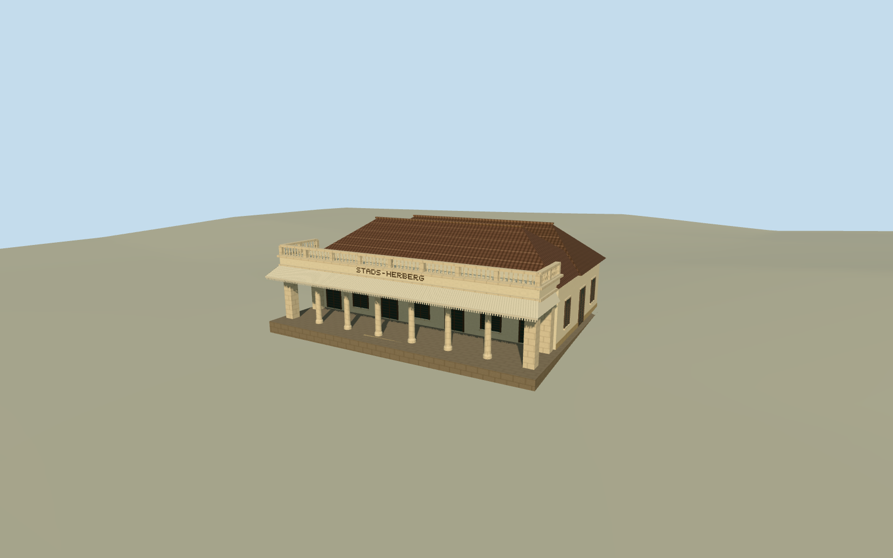

# Stadsherberg, Batavia

The 1860s Stadsherberg inn on the east quay of old Batavia, with eight columns, a balustraded veranda, a fabric awning and tiled hip roofs.

Authoring state: **review-in-qa.json**. Current completion evidence is in [qa.json](qa.json) and the [completion ledger](../../../../qualla-structures/batches/qualla-004.PROGRESS.md).

- [The Inn at the Edge of Empire](https://qualla.com/stadsherberg-batavia/)

The cadastral map and photograph alignment locate the former inn to about 30 m. The building is demolished.

The model uses the late 1860s awning. Roof tile color, rear wing size, glazing and service elevations are interpreted from the black-and-white views.

Only the inn is represented. The separate customs and landing facilities are outside its footprint.

Build: `node content/worldgen/source/places/qq/qqg/stadsherberg_batavia/models/generate-stadsherberg-batavia.mjs`. Add `--check` to verify exact regeneration. 10471 triangles; 7 materials; no embedded photographs.
