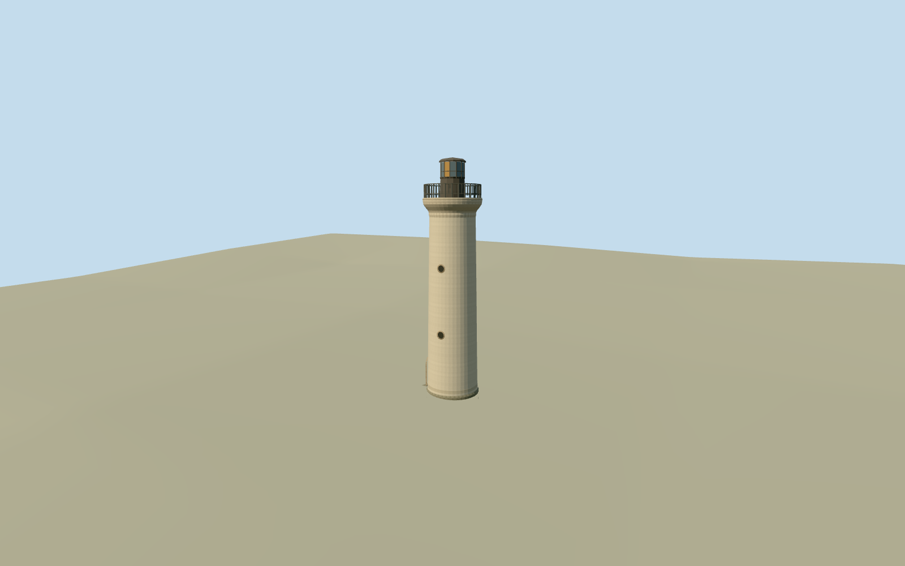

# Sunda Kelapa Lighthouse

The round white tower of Sunda Kelapa Lighthouse with two portholes, a projecting stone gallery and its historic glazed lantern.

Authoring state: **review-in-qa.json**. Current completion evidence is in [qa.json](qa.json) and the [completion ledger](../../../../qualla-structures/batches/qualla-004.PROGRESS.md).

- [The Lighthouse That Defined Zero](https://qualla.com/sunda-kelapa-lighthouse/)

Draft exterior: approximate photographic proportions and simplified ornament. It is not a survey, photogrammetric reconstruction or approved current geographic replacement.

The 1875 Woodbury and Page waterfront photograph shows the tapered shaft, two round windows, corbelled gallery and glazed cylinder. The mapped shaft is approximately 3.55 m across.

Terrain sampling/contact, geographic alignment and site activation remain pending. Runtime LODs are produced by the registered after-import pipeline and require visual review.

Reference photos remain in the local Qualla corpus; only provenance, paths and hashes are retained here.

Build: `node content/worldgen/source/places/qq/qqg/sunda_kelapa_lighthouse/models/generate-sunda-kelapa-lighthouse.mjs`. Add `--check` to verify exact regeneration. 3709 triangles; 6 materials; no embedded photographs.
