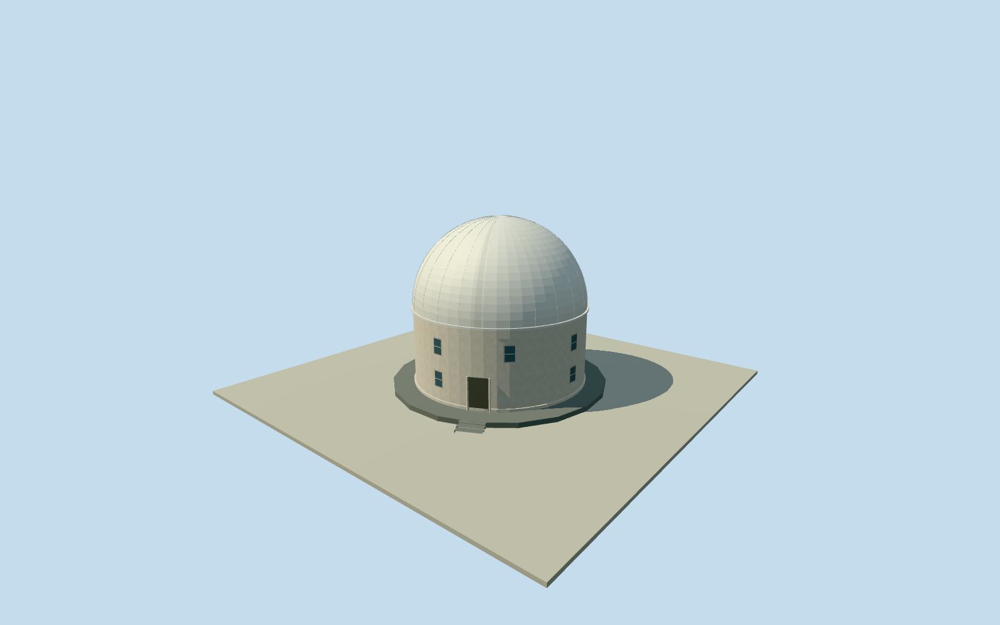

# Bosscha Zeiss Dome — Lembang

Whole Bosscha Zeiss dome building (Gedung Koepel) associated with The Tea Planter’s Telescope story: full original mapped circular base envelope, cylindrical exterior walls, full14.5m steel rotating dome in a closed static pose, support/rotation band, entrance and windows. Other discrete observatory buildings, telescopes, landscaped campus and interiors are separate structures excluded. Owner instrument record gives14.5m dome diameter and2mm steel construction; native outline supplies full horizontal base. Native outer ring interpreted as base/apron rather than dome diameter. Wall height, vertical profile, ring divisions, shutter seam, door/window census/bearings, base divisions and finishes are bounded estimates. No photographs, drawings or figures used and no photographic fidelity claimed.

Authoring state: **review-in-qa.json**. Current completion evidence is in [qa.json](qa.json) and the [completion ledger](../../../../qualla-structures/batches/qualla-002.PROGRESS.md).

- [The Tea Planter's Telescope](https://qualla.com/bosscha-observatory/)

Whole Bosscha Zeiss dome building (Gedung Koepel) associated with The Tea Planter’s Telescope story: full original mapped circular base envelope, cylindrical exterior walls, full14.5m steel rotating dome in a closed static pose, support/rotation band, entrance and windows. Other discrete observatory buildings, telescopes, landscaped campus and interiors are separate structures excluded. Owner instrument record gives14.5m dome diameter and2mm steel construction; native outline supplies full horizontal base. Native outer ring interpreted as base/apron rather than dome diameter. Wall height, vertical profile, ring divisions, shutter seam, door/window census/bearings, base divisions and finishes are bounded estimates. No photographs, drawings or figures used and no photographic fidelity claimed.

Owner instrument record gives14.5m diameter/2mm steel construction and56ton dome. Native19-control circle is interpreted as outer foundation/apron; main cylindrical wall is aligned concentrically to the dome. Exact vertical wall height, dome curvature, rotation/shutter band proportions, window/door census/bearings and apron division are declared reconstruction estimates. Overall14.05m height is estimated, not measured.

Closed static dome exterior only; meridional shutter seams/rails are symbolic estimated fittings. No rotating roof animation, open aperture/telescope interior, exact panel census, photogrammetry or detailed current-condition claim. Other campus structures are separate buildings excluded.

Offwhite wall/roof, dark foundation and door/glazing finishes are procedural visualization estimates, not sampled from photographs. All Qualla and external imagery unused, including conflicted hero/stamps/archival copies. No media/article/rights metadata repair.

Original independent128m/16641value terrain and frame frozen before floor/main sections. Floor0 at original centroid datum; coastal/provider/canopy/DEM and ground-contact uncertainty retained. No masks, flattening, cutouts, re-acquisition or visual field/floor/section fitting.

Dated approximate2025representation, not certified for automatic current-world replacement or2026restoration condition.

Build: `node content/worldgen/source/places/qq/qqu/bosscha_zeiss_dome/models/generate-house.mjs`. Add `--check` to verify exact regeneration. 8210 triangles; 5 materials; no embedded photographs.
