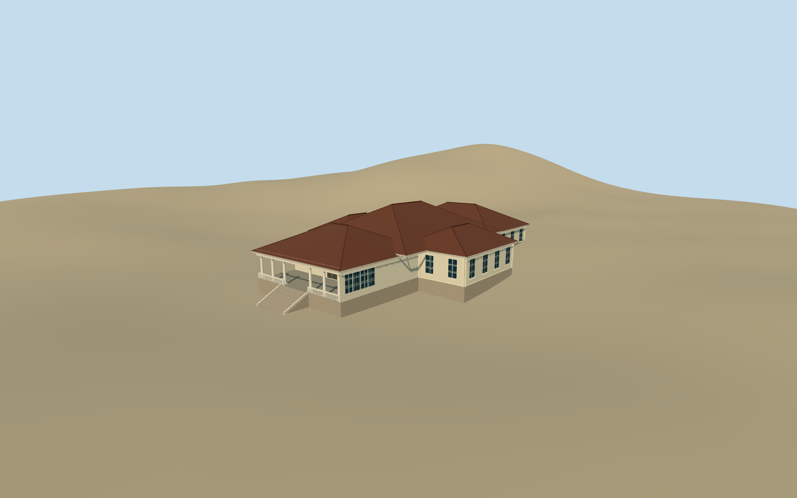

# Cipanas Palace

Single-storey tropical colonial villa at Cipanas, with the raised teak and glazed east veranda, broad eleven-step stair, clay hipped roofs, and a long shallow veranda facing the mountain slope.

Authoring state: **review-in-qa.json**. Current completion evidence is in [qa.json](qa.json) and the [completion ledger](../../../../qualla-structures/batches/qualla-003.PROGRESS.md).

- [Cipanas Palace](https://qualla.com/cipanas-palace/)

Exterior reconstruction. Exact roof angles, exterior window spacing, ridge and porch details, glazing and rear elevations are approximate. The original mid-nineteenth-century drawing establishes the broad historic form.

Covers the main residence only. Gedung Bentol, the pavilions, the baths, landscaped grounds and interiors are outside this model.

Build: `node content/worldgen/source/places/qq/qqu/cipanas_palace/models/generate-cipanas-palace.mjs`. Add `--check` to verify exact regeneration. 4524 triangles; 6 materials; no embedded photographs.
