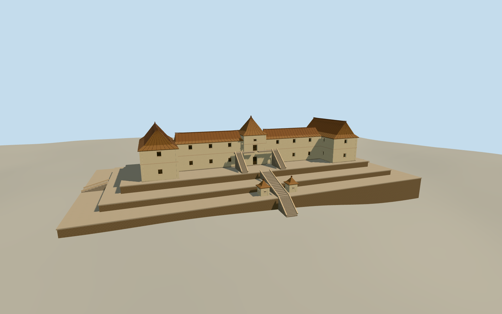

# Pulo Kenanga Water Castle

Gedhong Panggung, the intact five-part palace on Pulo Kenanga in Yogyakarta, with tall reddish earthen tile roofs, pale walls and stepped approaches circa 1859.

Authoring state: **review-in-qa.json**. Current completion evidence is in [qa.json](qa.json) and the [completion ledger](../../../../qualla-structures/batches/qualla-003.PROGRESS.md).

- [The Water Castle That Drowned Itself](https://qualla.com/taman-sari-yogyakarta/)

The circa-1859 reconstruction covers Gedhong Panggung and its immediate terraces. The neighboring pavilions, bath complex, tunnels and former lake are outside the exterior scope.

The measured provincial survey fixes the room sizes, story levels and lower terrace dimensions. Roof pitches, tile shades, stair runs, ground level and the upper terrace outline are approximations.

The historic building is aligned to the provincial register coordinate and the surviving map outline. The independent ground review uses modern source heights. Historic water level and vertical registration are unknown.

Build: `node content/worldgen/source/places/qq/qqw/pulo_kenanga_water_castle/models/generate-pulo-kenanga-water-castle.mjs`. Add `--check` to verify exact regeneration. 16938 triangles; 5 materials; no embedded photographs.
