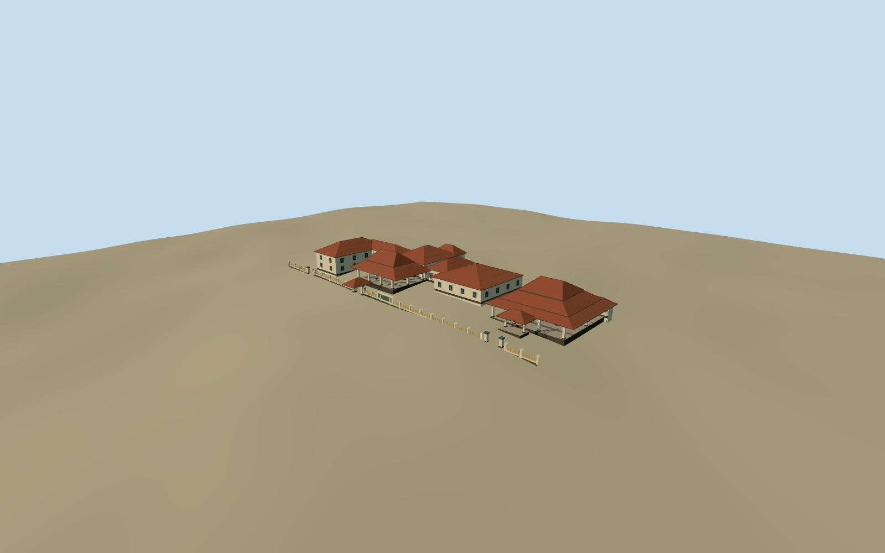

# Sonobudoyo Museum

Yogyakarta’s historic Sonobudoyo Unit I with the open Karsten pavilion, terracotta joglo roofs, gate, western wing and three-tier Pendapa Kesenian.

Authoring state: **review-in-qa.json**. Current completion evidence is in [qa.json](qa.json) and the [completion ledger](../../../../qualla-structures/batches/qualla-003.PROGRESS.md).

- [Sonobudoyo Museum](https://qualla.com/sonobudoyo-museum/)

The current map controls the site and roof envelopes. Heights, exact roof pitch, wood joinery, painted moldings and back elevations are estimated.

The model focuses on the surviving historic visitor complex. Modern exhibit buildings, the distinct Unit II, and secondary buildings outside the modeled yard are outside this geometry.

White masonry frontage and orange clay roofs are supported by the public-domain image. Sculptures, distinctive modern lettering and decorative panel artwork were excluded.

Build: `node content/worldgen/source/places/qq/qqw/sonobudoyo_museum/models/generate-sonobudoyo-museum.mjs`. Add `--check` to verify exact regeneration. 7128 triangles; 6 materials; no embedded photographs.
