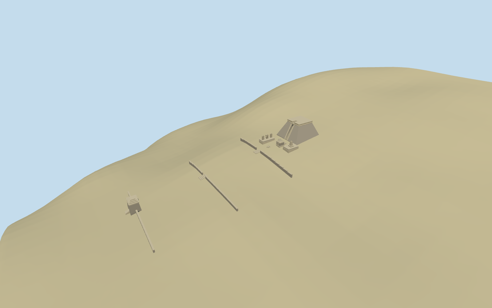

# Sukuh

Specific standing Sukuh core: broad flat-topped sloping stone pyramid with true narrow west stair channel and dressed cheeks/upper lintel, moulded summit band, low north/south platforms, small Bhimaswarga relief shrine, original simplified stela/Garuda/turtle vocabulary, western tapered stone gateway with real passage and Kala-like lintel relief, and short terrain-following terrace retaining edges/approaches. Preserve open native-ground courts and independent modern buildings. No roofed summit restoration, copied narrative/text relief or complete interiors.

## Evidence and reconstruction

Published dimensions and reconstructed details are separated in spec.json. Primary references:

- [Reference](https://commons.wikimedia.org/wiki/File:Platform,_Candi_Sukuh_1226.jpg)
- [Reference](https://commons.wikimedia.org/wiki/File:Candi_Sukuh_2007.JPG)
- [Reference](https://commons.wikimedia.org/wiki/File:Gate_with_Kala,_Candi_Sukuh_1223.jpg)
- [Reference](https://commons.wikimedia.org/wiki/File:Sukuh_Plan.jpg)

Deterministic specific Sukuh pyramid, five mapped core envelopes, west stair shaft, upper platforms/shrine, western gateway and original simplified stone sculpture. Two existing shared256-square stone graphs, metric UVs, linear tints and four browser levels; no embedded images or copied relief/text.

## Model and axes

6,868 triangles; 20,604 vertices; 2 material groups; 826,156 bytes. Native bounds: -86.473, -15.108, -20.475 to 8.763, 7.966, 25.095. Source hash: `sha256:1a8eaf09b15c09ea43eca5d7be9f467d133f09417f8aee2cd5d12aceea127507`.

{"x":"east","y":"up","z":"south"}

The geographic proposal uses exact-QID OpenStreetMap evidence. Map-derived orientation and estimated architectural details require real-site visual review; preview eligibility is distinct from geographic/fidelity approval. Map attribution: © OpenStreetMap contributors, ODbL-1.0.

## Reproduce

Run `node packages/worldgen/scripts/generate-additional-landmarks.mjs --ids=N0538` (or add `--check`). The generator preserves manually edited masters by checking their baseline hashes. Import through the standard authored-model workflow with optimization disabled; then capture all QA cameras, including shared-surface views.

## Pending work

- Specific standing Sukuh core: broad flat-topped sloping stone pyramid with true narrow west stair channel and dressed cheeks/upper lintel, moulded summit band, low north/south platforms, small Bhimaswarga relief shrine, original simplified stela/Garuda/turtle vocabulary, western tapered stone gateway with real passage and Kala-like lintel relief, and short terrain-following terrace retaining edges/approaches. Preserve open native-ground courts and independent modern buildings. No roofed summit restoration, copied narrative/text relief or complete interiors.
- Exact-QID Q3101506/way646444755 and named standard building/POI35185018533587 establish the main approximately16.5x14.8m pyramid. Four additional map controls35185018533590..35185018533593 align with the western gate, north platform, south platform and small shrine in the ordinary precinct sketch. Anchor111.131537336,-7.627315249; heading0, internal local+x angle+.054081447315rad, west-front along local-x. Main mapped dimensions/positions are retained; internal stair, sculpture and terrace allocation are picture/map-led approximations.
- Picture-led main pyramid about8.7m above west threshold, roughly16.3x14.6m base/9x9m top, narrow1.1m stair channel. Gate about5.2m above local floor,3.9x5.5m mapped envelope. Detached platforms about.65m, small relief shrine about2.5m; original simplified sculpture/stela stations, mouldings, course rhythm and retaining-edge heights are approximate, not surveyed reconstruction.
- Retain original standard6m Mapzen ground/water and independent buildings. Small local level bases have constant buried bottoms sampled along all boundaries. Main pyramid front threshold follows local west grade; its lower body is buried into uphill grade. Gate and detached platforms use separate local floors; short approach steps and narrow retaining edges follow native slope. No broad flattened terrace/island slab or ground/water cutout. Coarse wooded DEM does not resolve exact archaeological terrace/paving/door thresholds; relative and absolute elevations remain approximate.
- Internal stair channel, summit band, sculpture/stela inventory, gateway form, retaining edges and terrace thresholds are ordinary-picture/map approximations. No copied narrative relief/text, roofed summit restoration or museum interior. Open native-ground courts, trees and independent modern buildings remain host context.

This bundle follows the medium-fi standard. Medium-fi appearance and geographic fit are reviewed separately. Hash-bound visual acceptance is recorded separately after capture inspection.

## Additional geographic data

©OpenStreetMap contributors; Protomaps; Mapzen/USGS terrain.
