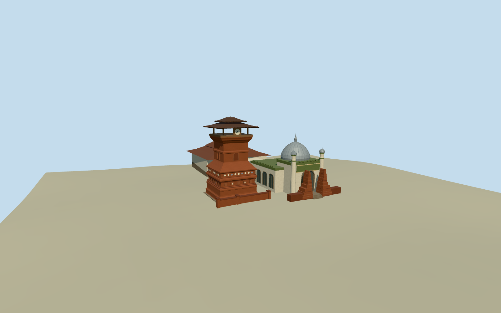

# Menara Kudus Mosque

The stepped red brick Menara Kudus beside the mosque’s silver dome, white entrance and red split gate.

Authoring state: **review-in-qa.json**. Current completion evidence is in [qa.json](qa.json) and the [completion ledger](../../../../qualla-structures/batches/qualla-004.PROGRESS.md).

- [Menara Kudus Mosque](https://qualla.com/menara-kudus-mosque/)

The front reaches, minaret registration, and hall links follow the surveyed site relationships and approximate roof controls. Separations and secondary volumes are estimates.

The exterior includes the historic minaret, photographed mosque entry and associated prayer hall. The cemetery and outlying auxiliary buildings are outside scope.

Small carved plaques, colours after subsequent repairs, and unpublished prayer-hall elevations are approximate.

Build: `node content/worldgen/source/places/qq/qqy/menara_kudus_mosque/models/generate-menara-kudus-mosque.mjs`. Add `--check` to verify exact regeneration. 11627 triangles; 8 materials; no embedded photographs.
