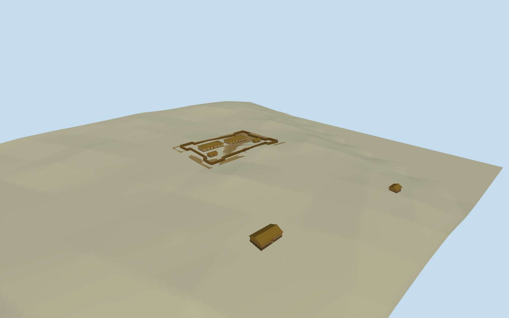

# Fort Dundas

Fort Dundas in 1824 with the timber enclosure, paired thatched officers’ ranges and two sheds down the Barlow Point slope.

Authoring state: **review-in-qa.json**. Current completion evidence is in [qa.json](qa.json) and the [completion ledger](../../../../qualla-structures/batches/qualla-004.PROGRESS.md).

- [Fort Dundas](https://qualla.com/fort-dundas/)

The 1824 structures no longer stand. The date, anchor and approximate orientation mark a historic reconstruction on current terrain.

Roof pitch, gate appearance, building pad heights and the exact position of the two lower sheds are estimates from the contemporary engraving and written record.

Build: `node content/worldgen/source/places/qv/qvu/fort_dundas/models/generate-fort-dundas.mjs`. Add `--check` to verify exact regeneration. 23670 triangles; 5 materials; no embedded photographs.
