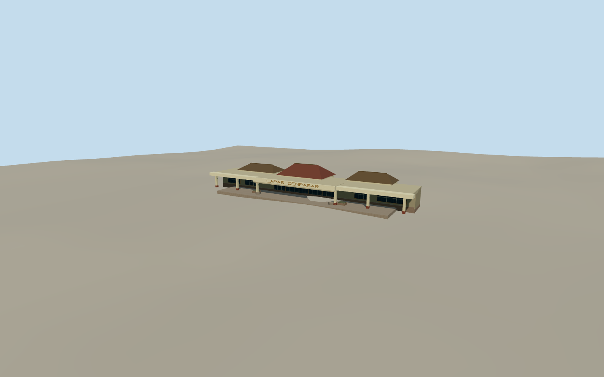

# Kerobokan Prison

Kerobokan Prison’s publicly visible reception façade at Jalan Gunung Tangkuban Perahu, with its long cream canopy and raised Lapas Denpasar name.

Authoring state: **review-in-qa.json**. Current completion evidence is in [qa.json](qa.json) and the [completion ledger](../../../../qualla-structures/batches/qualla-003.PROGRESS.md).

- [Hotel K](https://qualla.com/kerobokan-prison/)

The model covers the public reception frontage from the street. The dimensions and setback of the canopy are architectural estimates, and the low roof shapes immediately behind are simplified.

The exterior is based on the documented 2012 appearance linked in Qualla. Roof spacing, side elevations, planter detail and trim finishes are approximate.

The terrain is independently sampled and unchanged. The grade beneath the façade comes from that source.

Build: `node content/worldgen/source/places/qw/qw3/kerobokan_prison/models/generate-kerobokan-prison.mjs`. Add `--check` to verify exact regeneration. 1464 triangles; 6 materials; no embedded photographs.
