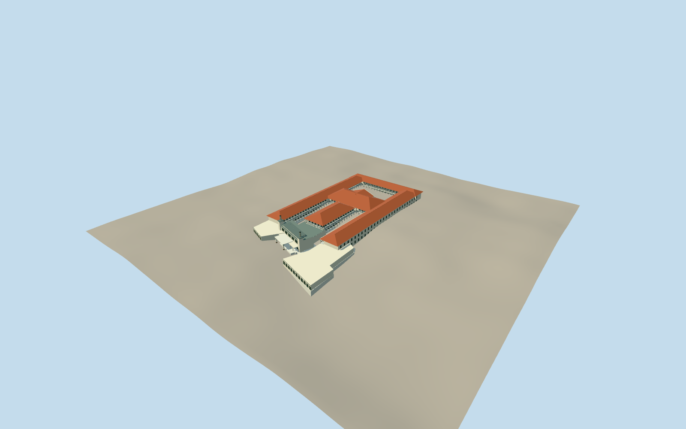

# Hotel Majapahit

Cream Art Deco entrance with twin glazed beacons, stepped parapets and projecting canopy; red hipped-roof courtyard wings with open arcades and a pedimented classical crosswing.

Authoring state: **review-in-qa.json**. Current completion evidence is in [qa.json](qa.json) and the [local 100 ledger](../../../../qualla-structures/batches/PROGRESS.md).

- [Hotel Majapahit: Where a Torn Flag Sparked a Revolution](https://qualla.com/hotel-majapahit/)

Original medium-fi exterior based on individually inspected Qualla entrance, courtyard and classical crosswing photographs; interiors excluded.

Mapped compound and official aerial view control layout; heights, gallery depths, window spacing, roof joins and hidden elevations remain photographic estimates.

Later eastern pool/service wing excluded by an explicit scope cut. Simplified original relief; no photo textures or exact crests/lettering copied.

Independent coarse Terrarium ground remains unmodified; local foundations and host terrain compatibility are approximate.

Build: `node packages/worldgen/scripts/generate-authored-places.mjs --ids=hotel_majapahit`. Add `--check` to verify exact regeneration. 50045 triangles; 5 materials; no embedded photographs.
