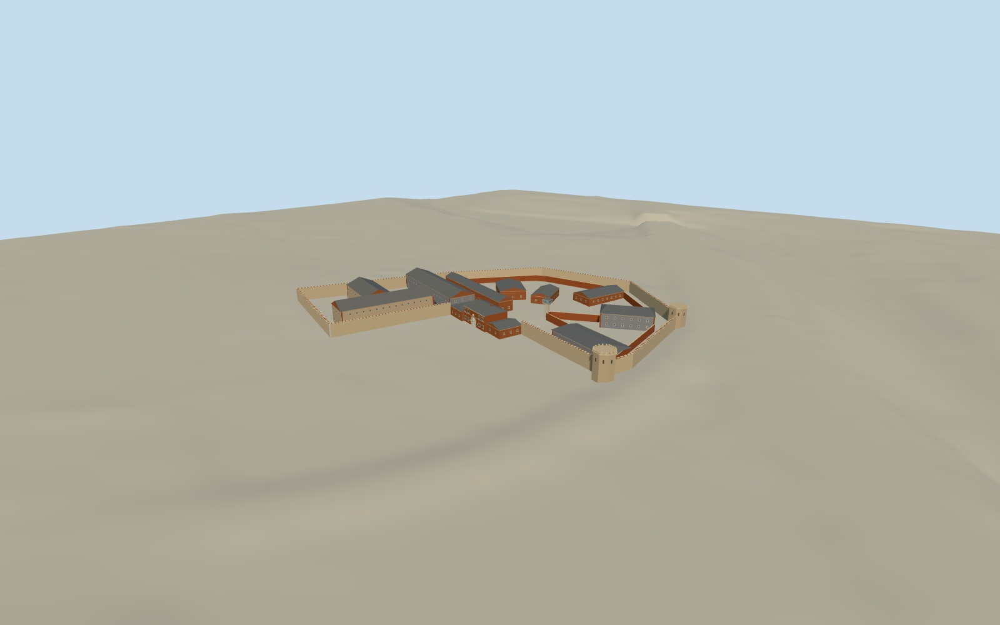

# Adelaide Gaol

Adelaide Gaol with its Georgian administration range, original limestone walls and octagonal towers, radial prison yards and 1879 T-shaped cell range.

Authoring state: **review-in-qa.json**. Current completion evidence is in [qa.json](qa.json) and the [completion ledger](../../../../qualla-structures/batches/qualla-003.PROGRESS.md).

- [Adelaide Gaol](https://qualla.com/adelaide-gaol/)

Most individual roof profiles, finished grade contacts and opening schedules are exterior estimates. The public-domain photograph fixes the central sandstone arch and white studded doors.

The original terrain preserves the mapped context and samples the approach at composite raster resolution.

The administration frontage is assigned to the south edge of the mapped 232525390 roof. The precise doorway position, the height along the southeast curtain, and the modern watch tower section are inferred.

Build: `node content/worldgen/source/places/r1/r1f/adelaide_gaol/models/generate-adelaide-gaol.mjs`. Add `--check` to verify exact regeneration. 13480 triangles; 8 materials; no embedded photographs.
