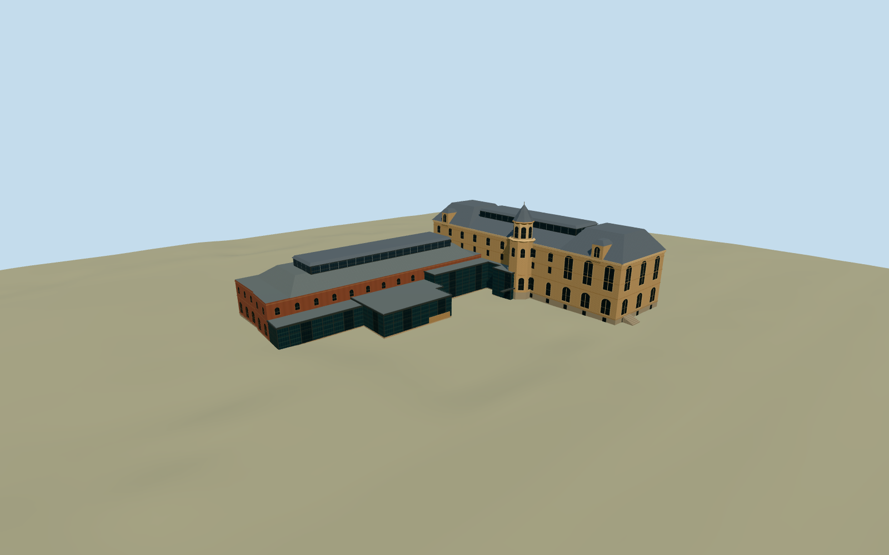

# South Australian Museum

The linked main museum building with a Romanesque stone East Wing and slate tower, red-brick North Wing, and low black-framed public entrance.

Authoring state: **review-in-qa.json**. Current completion evidence is in [qa.json](qa.json) and the [completion ledger](../../../../qualla-structures/batches/qualla-003.PROGRESS.md).

- [South Australian Museum](https://qualla.com/south-australian-museum/)

The native footprint controls the 19-point main shell. The old East Wing courtyard tower and shallow trim project into the court. Later wing joins and current roof heights are estimates.

The historic photo controls the west-facing stone elevation and roof silhouette. Stone openings on less visible sides, the rear service elevation, metalwork and glass mullion subdivisions are approximated.

The original Terrarium crop controls the site context. Local threshold and retaining-wall elevations are estimated from the surrounding terrain.

The scope is the main public building. The adjoining library, sculpture and other landscape objects are represented by their own placements when available.

Build: `node content/worldgen/source/places/r1/r1f/south_australian_museum/models/generate-south-australian-museum.mjs`. Add `--check` to verify exact regeneration. 11563 triangles; 6 materials; no embedded photographs.
