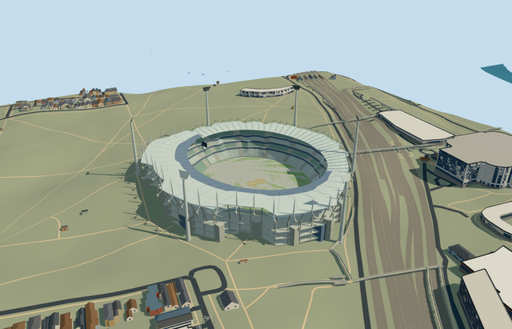

# melbourne_cricket_ground — Melbourne Cricket Ground

Reviewed 2026-10-20 in one continuous author/build/inspect/fix round.

## Appearance

Inspected48 current source/shared/sky-reflected medium-fi/native-Melbourne views in one ordinary-picture/PMTiles/build/inspect/fix pass. Own four-part stadium annulus/open cricket oval, four green-grey seating banks/three closed hospitality fronts/pale aisles, lower teal-framed southern canopy and taller pale northern stayed canopy/26 near cigar masts/crossed stays/rigid counterweight nodes/renderable undersides/radial steel, recessed concrete-glazed services/galleries/projecting cores/three approximate atriums, six tapered white towers/flared grid heads, neutral central cricket block/active strip/crease/stumps/boundary rope/two supported displays are intact. Corrected retaining-floor underside to lie below the field when all sampled outer grades are positive. All captures current after that correction. Northern/southern roofs remain distinct, no copied crowd/emblems/event boards or proposed replacement. Native grade can obscure the lower retaining base; portable flat context is separate from geographic evidence.

## Shared materials and browser levels

Four existing256-square graphs: concrete_plain, metal_painted, fabric_canvas and window_grid. Concrete supplies services/cores/galleries/common floor; tinted paint supplies green-grey seats/pale northern steel/teal southern framing/white towers/grid lamps/counterweight connections/cricket strip/neutral displays; shared canvas supplies pale canopy and turf grain; window-grid supplies opaque hospitality/atrium glazing and northern leading roof strip. Roof/wall canvas slots create five near draws. Zero embedded images or unique atlas; each nearby graph read once. Metric UVs/linear palette conversion/separate POSITION and NORMAL uploads/equal reported CPU and GPU geometry bytes pass. Shared opaque glazing is an approximation of original glass/roof transmission.

| Level | Triangles | Bytes | Draws |
| --- | ---: | ---: | ---: |
| skyline | 996 | 94316 | 1 |
| district | 3948 | 364168 | 5 |
| street | 15284 | 1382488 | 5 |
| closeup | 50680 | 4625548 | 5 |

Inspected24 noon/late Economy/High street/block/skyline/silhouette/matched-level/transition frames with viewer sky reflections and active model-owned opening/original sample values unchanged. Four levels retain complete oval/four tiers/two roof profiles/six light silhouettes. Near levels refine rows/aisles/26 northern cigar masts/stays/teal southern trusses/grid heads/cores; far levels group masts and omit hidden belt undersides/subpixel framing, with walking floors/fronts and solid triangular tower proxies retained. Skyline12m declared error allowance; other levels2/1.2/.25m. Initial skyline plus district458484bytes, below3MB phone/6MB laptop targets. Synthetic neighboring buildings are not geographic evidence. Physical ordinary-laptop/phone/tablet/dense-city timings remain pending. Levels996/3948/15284/50680 triangles; at most five draws.

## Approximate map fit

RetainedQ330136/named native MCG stadium POI35184582426090/mapped playing oval35184380126371 identify the four owned stand parents35184404089362/35184503798104/35184503798105/35184503798106; no exact-QID map field. Their union gives92-point outer/57-point hole, approximately306x282m body/173.41487100725777x147.9448484353963m playing oval. Anchor[144.98345418574502,-37.81998375514588]/heading0/native east-south/internal X[.9716681034308167,-.23634952247711402]/Z[.23634952247711402,.9716681034308167]. Native southern-parent coverage controls roof split; oval axis distinct from smaller mapped inner circle35185415679220. All four native records fully removed/zero residual area; all310 independent resident inputs of314 originals unchanged, all802 wider independent footprints of806 records disjoint from two-piece50mm-guard mask. Tower/atrium/projecting-core footprints also checked against independent buildings. Original6m grid/datum7.905704937627306m/native roads/176870.68774482072m2 resident source water unchanged. Working field0/retaining floor below datum/individual retained frame-tower-atrium contacts/bounded opening within90percent body address outer grade2.1215503416159436..24.840812372699425m. Failure retains314 originals/original ground; every level unload restores ground/water/zero model geometry. Park/arenas/kiosks/statues/transport remain separate, no blanket park/plaza slab.

## Limits

Four ordinary photographs actually viewed: two COX night northern exterior/roof-detail photographs, plus Austadiums2021 daylight aerial and December2023 Boxing Day cricket interior. COX collectively credits John Gollings/Peter Hyatt; first filename names Gollings, second individual attribution/exposure dates unspecified. Austadiums viewer does not name individual photographers. Copyright retained/viewed only/no photo pixels/crowd/event artwork copied. COX301034_00_N5_medium.jpg was also viewed but is an architectural elevation, not an additional ordinary photograph. Current source depicts reference-era existing stadium; proposed southern redevelopment excluded. COX describes four tiers and26 cigar-shaped northern masts; closeup follows26-member concept but exact placement/connection inventory is approximate. Native heights45m south/50m north have unqualified datum. Working banks1.4..10,13..17,20..24,27..37.5m/belts10..13,17..20,24..27m/southern rear canopy40.5+.5cos2a/northern rear45..47m/inner drops1m and2m/mast8..22m above canopy/towers75m above each retained foot plus7m fan heads/atrium approximately24m/core28m/display24..31m are picture-led allocations. Neutral28x14m cricket block/20.12x3.05m active strip/approximate north-south direction is not a qualified current pitch setup. Tower/atrium/display/core placement, rows/aisles/grids/counterweights and20degree/2m fine facing are estimates. Shared opaque roof/glazing does not reproduce exact optics; static geometry/standard DEM do not certify engineering/access/hidden furnished museum/interior/current condition. Physical ordinary-laptop/phone/tablet/dense-city timings remain pending.

## Selected checks

Six Khronos files: zero errors/warnings.19176 actual mesh/material/contact checks; 48 current inspected views. Scene validation/sim30 and strict selected medium-fi audit pass. Source/runtime/LOD hashes and material bindings verified.

Rebuild: node packages/worldgen/scripts/generate-additional-landmarks.mjs --ids=melbourne_cricket_ground; node packages/worldgen/scripts/import-structure-models.mjs --ids=melbourne_cricket_ground; node packages/tooling/scripts/generate-landmark-lods.mjs --ids=melbourne_cricket_ground --force.

Source: sha256:9bbf8af47d2376af55c5703ee3e8e7619a7d8e0d4b78d166c7b7100f23ff2ace

Runtime: sha256:050e81c8ca8aa85f18b8a3aff7efe41aec6a39be8308567b163c7c1b0b5b03a5

Input: sha256:ec59191ac10811d9e204fd45f7f07d1571082c165b7a7204407159431e9cfb65

## Viewed ordinary pictures

https://www.coxarchitecture.com.au/project/mcg-northern-stand/ — https://www.coxarchitecture.com.au/wp-content/uploads/2019/08/MCG-Northern-Stand-Redevelopment-1_2-Gollings-Photography_RGB-e1454485190224.jpg; John Gollings, Peter Hyatt collectively credited by COX; filename names Gollings Photography; Copyright retained; viewed only. Viewed only; no pixels copied.

https://www.coxarchitecture.com.au/project/mcg-northern-stand/ — https://www.coxarchitecture.com.au/wp-content/uploads/2019/08/MCG-Northern-Stand-Redevelopment-2_5-e1454389812604.jpg; John Gollings, Peter Hyatt collectively credited by COX; no individual attribution for this image; Copyright retained; viewed only. Viewed only; no pixels copied.

https://www.austadiums.com/stadiums/mcg/photos — https://www.austadiums.com/stadiums/photos/MCG-aerial-2021.jpg; Austadiums gallery; individual photographer not supplied in viewer; Copyright retained; viewed only. Viewed only; no pixels copied.

https://www.austadiums.com/stadiums/mcg/photos — https://www.austadiums.com/stadiums/photos/MCG-boxing-day-test-23.jpg; Austadiums gallery; individual photographer not supplied in viewer; Copyright retained; viewed only. Viewed only; no pixels copied.
