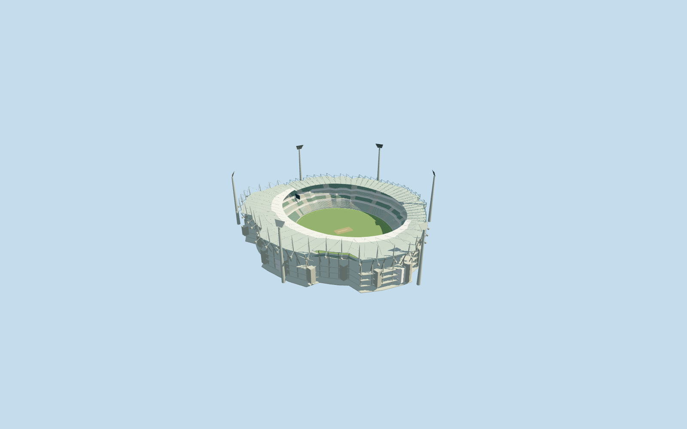

# Melbourne Cricket Ground

Specific reference-era Melbourne Cricket Ground: own four-part mapped stadium annulus/open grass cricket oval, four green-grey seating banks/three closed hospitality belts/pale aisles, distinct lower teal-framed southern cantilever roof and taller pale northern stayed roof with26 near cigar masts/crossed stays/counterweight nodes/renderable undersides/radial framing, recessed concrete-glazed services/galleries/projecting cores/three main atrium estimates, six tapered white light towers/flared grid heads, central neutral cricket block/crease/stumps/oval boundary rope and two supported neutral displays. Four shared graphs, no copied photos/seat lettering/emblems/event boards/crowds/blanket plaza or hidden furnished museum. Far levels merge rows/repeated steel but retain oval/two roof systems/light towers.

## Evidence and reconstruction

Published dimensions and reconstructed details are separated in spec.json. Primary references:

- [Reference](https://www.coxarchitecture.com.au/project/mcg-northern-stand/)
- [Reference](https://www.austadiums.com/stadiums/mcg/photos)

Specific reference-era Melbourne Cricket Ground: own four-part mapped stadium annulus/open grass cricket oval, four green-grey seating banks/three closed hospitality belts/pale aisles, distinct lower teal-framed southern cantilever roof and taller pale northern stayed roof with26 near cigar masts/crossed stays/counterweight nodes/renderable undersides/radial framing, recessed concrete-glazed services/galleries/projecting cores/three main atrium estimates, six tapered white light towers/flared grid heads, central neutral cricket block/crease/stumps/oval boundary rope and two supported neutral displays. Four shared graphs, no copied photos/seat lettering/emblems/event boards/crowds/blanket plaza or hidden furnished museum. Far levels merge rows/repeated steel but retain oval/two roof systems/light towers.

## Model and axes

50,680 triangles; 152,040 vertices; 5 material groups; 6,085,028 bytes. Native bounds: -169.522, -0.400, -149.251 to 143.000, 104.654, 129.205. Source hash: `sha256:9bbf8af47d2376af55c5703ee3e8e7619a7d8e0d4b78d166c7b7100f23ff2ace`.

{"x":"east","y":"up","z":"south"}

The geographic proposal uses exact-QID OpenStreetMap evidence. Map-derived orientation and estimated architectural details require real-site visual review; preview eligibility is distinct from geographic/fidelity approval. Map attribution: © OpenStreetMap contributors, ODbL-1.0.

## Reproduce

Run `node packages/worldgen/scripts/generate-additional-landmarks.mjs --ids=melbourne_cricket_ground` (or add `--check`). The generator preserves manually edited masters by checking their baseline hashes. Import through the standard authored-model workflow with optimization disabled; then capture all QA cameras, including shared-surface views.

## Pending work

- Specific reference-era Melbourne Cricket Ground: own four-part mapped stadium annulus/open grass cricket oval, four green-grey seating banks/three closed hospitality belts/pale aisles, distinct lower teal-framed southern cantilever roof and taller pale northern stayed roof with26 near cigar masts/crossed stays/counterweight nodes/renderable undersides/radial framing, recessed concrete-glazed services/galleries/projecting cores/three main atrium estimates, six tapered white light towers/flared grid heads, central neutral cricket block/crease/stumps/oval boundary rope and two supported neutral displays. Four shared graphs, no copied photos/seat lettering/emblems/event boards/crowds/blanket plaza or hidden furnished museum. Far levels merge rows/repeated steel but retain oval/two roof systems/light towers.
- RetainedQ330136 reference/named native stadium POI35184582426090 and mapped playing oval35184380126371 identify MCG. Own parents35184404089362/35184503798104/35184503798105/35184503798106 dissolve into92-point outer/57-point inner annulus, approximately306x282m outer/173.414871x147.944848m playing oval. No exact-QID field in extract. Separate outer playing oval supplies own axis, not a soccer rectangle or the smaller mapped inner cricket circle35185415679220. Anchor[144.98345418574502,-37.81998375514588]/heading0/native east-south/internal X[0.9716681034308167,-0.23634952247711402]/Z[0.23634952247711402,0.9716681034308167]. Own native southern parent supplies southern/northern roof split. Cricket strip uses approximate geographic north-south direction; tower/atrium/display positions and20degree/2m fine facing remain photo-led estimates.
- Native southern parent height45m/northern parents50m have unqualified datum. Working field0/banks1.4..10,13..17,20..24,27..37.5m/three hospitality belts10..13,17..20,24..27m/southern roof rear40.5+.5cos2a and northern rear45..47m with inner drops1m/2m are picture-led allocations, not surveyed heights. COX describes26 cigar-shaped northern masts increasing over Members area: closeup follows26-member concept with working8..22m projection above canopy, grouped farther away. Six light towers75m above each own retained foot plus7m fan heads,24m atriums/28m core caps, two display24..31m and their fine placements are estimates. Central28x14m cricket block/20.12x3.05m active strip/north-south axis are neutral sporting visualization, not a qualified current strip setup. Shared roof/glazing is opaque; no exact optical/engineering/access/hidden interior/current condition certification. References include undated COX photos and2021/December2023 ordinary photos; proposed southern-stand redevelopment is excluded.
- Original6m Mapzen samples/native roads/water/all independent building inputs remain unchanged. Original datum7.905704937627306m defines occupied common field floor0; outer grade2.1215503416159436..24.840812372699425m reflects coarse standard DEM. Every frame/tower/atrium contact uses its own retained original sample. Only four owned stadium records replaced; independent kiosks/arenas/park/statues/transport remain native. Bounded opening within90percent body/all-level supported floor addresses interior terrain without editing original samples/outside ground/water or entire park/plaza. Failure/unload retain or restore original context.

This bundle follows the medium-fi standard. Medium-fi appearance and geographic fit are reviewed separately. Hash-bound visual acceptance is recorded separately after capture inspection.
