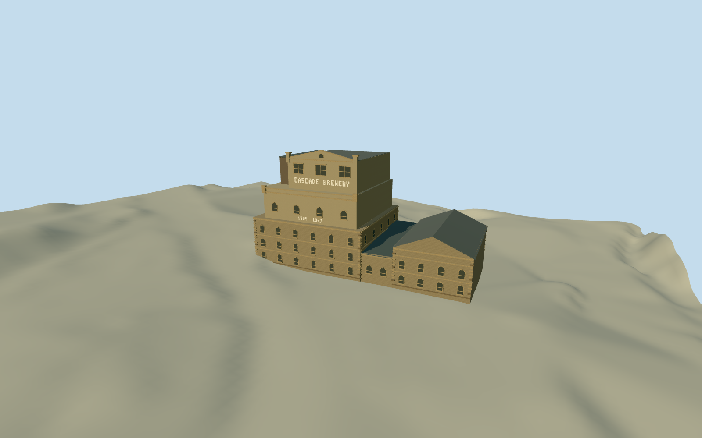

# Cascade Brewery

The historic South Hobart brewery with original sandstone lower walls, 1927 stepped upper floors, the painted façade lettering, and attached malthouse.

Authoring state: **review-in-qa.json**. Current completion evidence is in [qa.json](qa.json) and the [completion ledger](../../../../qualla-structures/batches/qualla-004.PROGRESS.md).

- [Cascade Brewery](https://qualla.com/cascade-brewery/)

Draft exterior: approximate photographic proportions and simplified ornament. It is not a survey, photogrammetric reconstruction or approved current geographic replacement.

The Beattie postcard shows three lower floors, sandstone courses and lower arched windows. The May 1937 public-domain newspaper photograph shows the added upper brewery and lettering. The heritage register describes the seven-level envelope, 1967 damage and low attached ranges.

Terrain sampling/contact, geographic alignment and site activation remain pending. Runtime LODs are produced by the registered after-import pipeline and require visual review.

Reference photos remain in the local Qualla corpus; only provenance, paths and hashes are retained here.

Build: `node content/worldgen/source/places/r2/r22/cascade_brewery/models/generate-cascade-brewery.mjs`. Add `--check` to verify exact regeneration. 11351 triangles; 7 materials; no embedded photographs.
