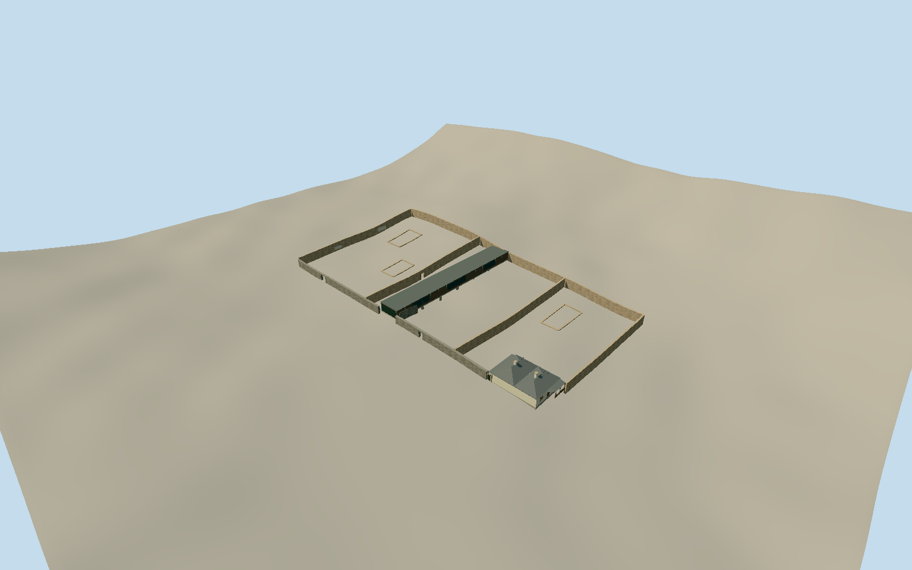

# Cascades Female Factory

Whole surviving heritage complex: adjoining Yards 1, 3 and 4 with high weathered stone enclosure/party walls, pedestrian gateways, reconstructed gabion boundary work, low archaeological foundation remnants, the Matron’s Cottage with twin hipped roofs, west/east verandas, north bay and chimneys, and the mapped modern History and Interpretation Centre. Lost roofed prison ranges, Yards 2/5 now developed, adjacent houses/industrial buildings, sculptures and independent art are excluded.

Authoring state: **review-in-qa.json**. Current completion evidence is in [qa.json](qa.json) and the [completion ledger](../../../../qualla-structures/batches/qualla-002.PROGRESS.md).

- [Cascades Female Factory](https://qualla.com/cascades-female-factory/)

Whole site way175529088/Q1046891/WHC1306-007 and actual Yard1/3/4 ways649855305/307/308 fix three adjoining open yards. The July2026 centre way649855310 fixes its approximately60m by8.4m linear footprint on the former Separate Apartments alignment; cottage649855312 fixes its notched footprint. +Z follows the centre toward Degraves Street; +X runs across yards toward the cottage. Heights, exact historic-versus-reconstructed wall lengths, portal positions, fine cottage roof partitions and centre roof/fenestration are bounded medium-fi estimates, not a measured section or photogrammetric reconstruction.

Before any geometry: centre floor fixed0.35m above independent source sample[-3,-25], cottage floor0.45m above[49,25]. Historic/gabion wall bases and low remnant toes sample the unchanged field; wall courses step/follow source grade. Floors are level authored slabs, foundation faces extend to the field, no field values altered. Provider-relative contact/actual slab elevations/footings remain approximate; geographic preview and replacement disabled.

Whole surviving conservation complex: three adjoining open yards, enclosure/party walls and pedestrian gateways, reconstructed gabion frontage, selected low archaeological foundation remnants, twin-hipped Matron cottage with open west/east verandas, bathroom infill/north bay, stabilized south arch/protective screen and chimneys; mapped post2022 linear interpretation centre. Historic roofed cell ranges are not restored, and demolished Yards2/5, surrounding houses/industrial sheds, sculptures, independent art and interiors are excluded.

One exact published Prout1844 PD-Australia lithograph provides historical context only; one Barrylb2009 own/self-CC0 yard original controls rough buff/gray sandstone, old plaster patches, repairs, gateway and low ruins. Cottage and modern-centre sections/opening census/roof profile derive from primary textual description with explicit unseen-detail estimates. No claim of current all-side photographic coverage, survey precision, complete archaeology, exact wall reconstruction chronology or all contemporary interpretation fixtures. No questionable Beattie image, modern CC/gallery/architectural copyrighted photos, competition renders, textures, borrowed meshes or generated bitmaps used.

Modern-centre footprint is native July2026 mapping, approximately60m by8.4m. Its low level roof, dark side walls, glazing census and gabion cheeks are bounded medium-fi estimates; no unbuilt competition amphitheatre or superseded ghost building is invented as current fabric. Primary construction descriptions establish precast supports, gabions and archaeology protection. Ground-derived wall stepping/foundation contacts remain approximate; original16641 elevations, heightfield and raw tile never flattened or fitted, replacement disabled.

Four LODs retain all three open courtyards, full centre/cottage volumes, gateway voids, cottage paired hips/north bay/verandas and chimneys. Near views add individual weathered stone face variation, gabion basket wires, plaster scars, window divisions/veranda balusters and arch voussoirs. Six actual canonical surface slots, five shared graphs and local glazing.

Build: `node packages/worldgen/scripts/generate-authored-places.mjs --ids=cascades_female_factory`. Add `--check` to verify exact regeneration. 18065 triangles; 6 materials; no embedded photographs.
