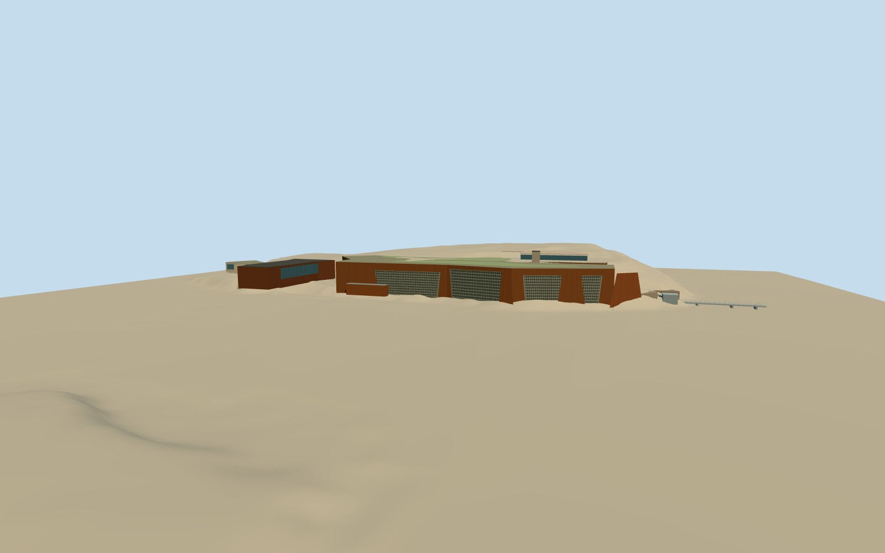

# Museum of Old and New Art

The standing Museum of Old and New Art under the Berriedale clifftop, with rusted steel walls, concrete grille bays, green roof, the white Courtyard House entrance and the ferry stair.

Authoring state: **review-in-qa.json**. Current completion evidence is in [qa.json](qa.json) and the [completion ledger](../../../../qualla-structures/batches/qualla-003.PROGRESS.md).

- [Museum of Old and New Art](https://qualla.com/museum-of-old-and-new-art/)

The shell positions and cuts are approximate within the independently mapped volume. The front bay proportions are derived from the river views. Exact roof levels, grille details, the nearby lower quay structures and Pharos and Round House finishes are estimates.

The terrain is the original rotated Tasmanian elevation field, including the riverbed. Cut edges, waterline and terrace contact are approximate and we apply no changes to the terrain.

The modeled scope covers the above-grade architecture and waterfront approach. Underground interiors, held art, exterior installations, winery, lodges and other detached estate structures are outside scope.

Build: `node content/worldgen/source/places/r2/r22/museum_of_old_and_new_art/models/generate-museum-of-old-and-new-art.mjs`. Add `--check` to verify exact regeneration. 3770 triangles; 7 materials; no embedded photographs.
