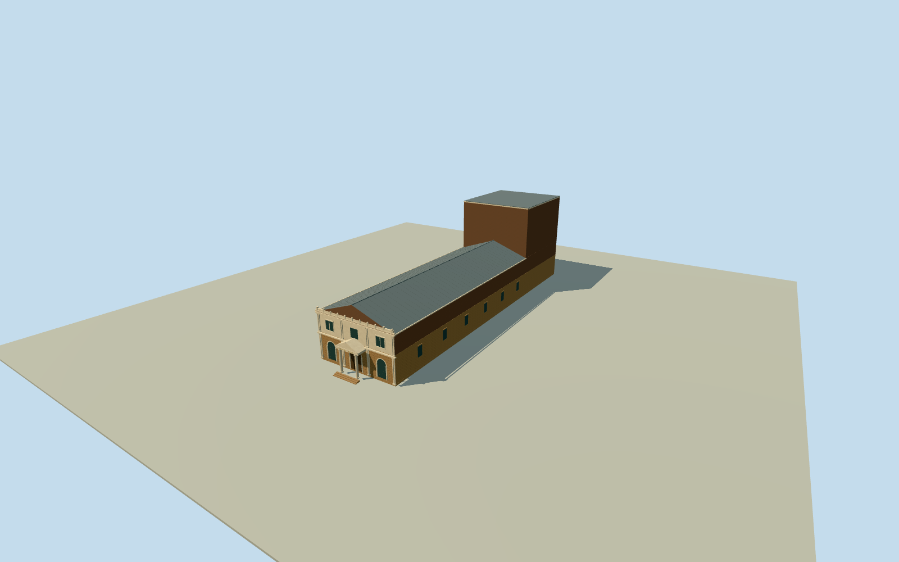

# Theatre Royal, Hobart

Entire historic TheatreRoyalHobart masonry building with fullauditorium/foyers/basement-exterior/mainroof and rear stage/flytower, both full longitudinal walls and VictorianAcademicClassical two-storey CampbellStreet facade/archedTuscanportico/triangularpediment. Exact original z15quantized numeric wholeway188586180 footprint and matching TheatreRoyalPOI, separateQ3523488identity. Stateheritage2024description supplies material/facade/storey/flytower>18m facts. Mapheight8m is generalized context, not a surveyed wholeflytower height. Exact elevations, sectiondivisions/roof profiles/flytower plan/opening census/ornament/text/finish/grade estimated. No adjacentHedberg/Hotel/campus/facade-only proxy, no imagery/interiors or photographic/survey/current replacement claim.

Authoring state: **review-in-qa.json**. Current completion evidence is in [qa.json](qa.json) and the [completion ledger](../../../../qualla-structures/batches/qualla-002.PROGRESS.md).

- [Theatre Royal, Hobart](https://qualla.com/theatre-royal-hobart/)

Entire historic TheatreRoyalHobart masonry building with fullauditorium/foyers/basement-exterior/mainroof and rear stage/flytower, both full longitudinal walls and VictorianAcademicClassical two-storey CampbellStreet facade/archedTuscanportico/triangularpediment. Exact original z15quantized numeric wholeway188586180 footprint and matching TheatreRoyalPOI, separateQ3523488identity. Stateheritage2024description supplies material/facade/storey/flytower>18m facts. Mapheight8m is generalized context, not a surveyed wholeflytower height. Exact elevations, sectiondivisions/roof profiles/flytower plan/opening census/ornament/text/finish/grade estimated. No adjacentHedberg/Hotel/campus/facade-only proxy, no imagery/interiors or photographic/survey/current replacement claim.

Exact original z15numeric four-corner whole-theatre footprint retained; source product is quantized/simplified rather than an OSMnode survey. Same-ID namedTheatreRoyalPOI/independentQ3523488 and Stateheritage12110 identify the physical original theatre, not neighboringHedberg/Hotel. Frontage15.21m/length60.52m are numeric-map derived, not surveyed dimensions.

Primary stateheritage2024page7 establishes two-storey frontage, lower rusticated sandstone, upperstucco/brick, doublepilasters/engagedTuscan columns, frieze/stringcourse, uppercornice/squatpilasterparapet, centralarchedTuscanportico/triangularpediment/giltname; rearstage has a flytower over18m. Only writtenfacts adopted, no reportphotos/plans/maps or protectedpixels.

Estimated providerrelativefloor0.3m, exposedbasement/plinth2.7mdeep, lowerfrontlevel4.6m/upper3.4m, mainwall8m/roofrise2.8m, gableprofile/ridges/metalfinish, fullwidthrear17.2mflytowerplan and18.6mheight abovefloor, cap/fittings allestimated. Source map8mheight is genericbasecontext, not a surveyed maximum that omits the tallerflytower. Exact floor/roof sections unknown; nominal mainheightuncertainty1.5m/flytower2m.

Facade threebay disposition, pilaster/column census and proportions, arch/door/window dimensions, cap/entablature/pediment/quoins/ornament profiles, rustication joints, plainnewproceduralletterstrokes/finish/paintcolors/windows/fittings allestimated. Full longitudinalwalls/auditorium/foyers/mainroof/rearflytower/basementexterior retained. Interiors/equipment, independentHedberg/Hotel/sitepaving/neighbors excluded; no facade/campusproxy.

Original128m/16641height sourcefield/singleoriginaltile acquired before all floor/mainsection choices. Datum13.817m and relativefield-6.87..7.18m include ground/building/canopy uncertainty. Preserve field/frame/floors/mainsections during review; no cutout/flatten/mask/refetch/refit for pictures. Geographicgroundcontact/verticalregistration approximate andunverified. Dated2024historical preview, no current-worldreplacement.

Qualla first6families/0conflicts; every photo/figure/video/drawing unused, including attribution-onlyfrontages, oldactors/posters and restrictivearchiveexteriors. Writtenstateheritagefacts only, no photographic/survey claim.

Build: `node content/worldgen/source/places/r2/r22/theatre_royal_hobart/models/generate-house.mjs`. Add `--check` to verify exact regeneration. 3627 triangles; 6 materials; no embedded photographs.
