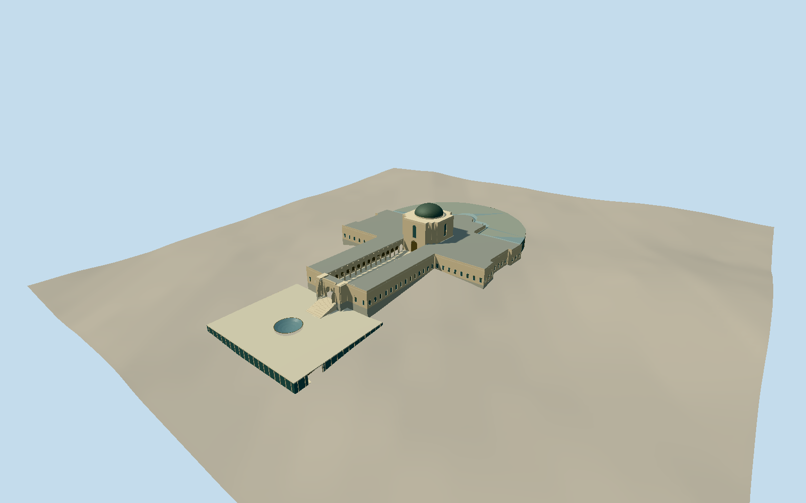

# Australian War Memorial

Whole current connected memorial complex: native T-shaped sandstone galleries and open commemorative court, genuine arched cloisters, stepped Hall of Memory and copper dome, low pyloned commemorative entrance, full northern semicircular new Anzac Hall/glazed-link footprint and modern southern entrance/forecourt with oculus and stairs. Adjacent offices/BeanResearchCentre/PoppysCafe/carpark, campus landscape and independent monuments/sculptures/interior exhibits excluded.

Authoring state: **review-in-qa.json**. Current completion evidence is in [qa.json](qa.json) and the [completion ledger](../../../../qualla-structures/batches/qualla-002.PROGRESS.md).

- [Australian War Memorial](https://qualla.com/australian-war-memorial/)

Relation7527080/Q782783, outer5090724(April2026), inner commemorative court520199710, Hall tower520199707/dome520199676 and entrance towers520199708/709 fix actual main geometry. Native northern semicircular building1489367025(March2026) and underground southern entrance1489659375(April2026), plus steps/parts1489603158/159/160, fix full connected modern extent. Anchor is native dome centre; +Z south-west down commemorative axis toward AnzacParade, +X south-east. Primary dome interior rises24m; exterior cap26m above authored Hall floor is an estimate. Modern exact glazing/roof sections/link division/oculus/foyer depth and opening census remain bounded estimates, not measured drawings. Erroneous native dome glass/3m tags do not override primary copper/24m-interior description.

Before geometry: level gallery/court floor0.35m above independent sample[0,30], Hall floor0.35m above[0,0], north hall floor0.35m above[0,-65], upper southern forecourt0.35m above[0,73], lower foyer0.35m above[0,124]. Intrinsic stairs connect these fixed levels; foundation toes alone consume source ground. Raw field/PNG/tiles unchanged, with no terrain flattening, fitting or reacquisition. Coarse DEM may include building/urban surface effects, so levels are provider-relative contact estimates; precise courtyard grading/slab excavation and host contact are unverified, geographic preview and replacement disabled.

Whole connected native2026 main memorial/court/tower/dome plus northern semicircular hall/link extent and southern underground-entrance roof/forecourt. No campus office/BeanResearchCentre/cafe/carpark, sculpture garden, independent monuments, interiors, people, inscriptions or copied artwork. Main horizontal outline and current added volumes are not replaced by a generic narrow facade model.

One exact published2006 creator-PD courtyard-edge image and two explicitly expired primary1946 KeithBenjaminDavis archive renditions were inspected. Both old exterior images show nearly the same west/north-west composition, not independent all-side coverage. They control older stone/gallery/tower/dome character only. Primary textual descriptions/current native geometry control modern additions; exact Anzac Hall roof/link partition, foyer/oculus position and section, bay/window census, wall/roof heights and fine finishes are bounded medium-fi estimates. No modern copyrighted gallery/architect pixels, CC/BSD imagery, questionable third-party public-domain-photo archive, DVIDS pixels, photographic textures, generated images or borrowed meshes used.

Cloister passages and commemorative entrance arch remain genuine voids, with recessed bronze Roll of Honour panels without copied names. Twin side porches and southern circular skylight are geometric structures. The apparent native glass/3m tag on the Hall dome is superseded by primary copper-cladding and24m interior-height evidence; exterior cap26m is explicitly estimated. Lower foyer and slab elevations/contact/excavation remain approximate, original16641 terrain values/PNG/four raw tiles unchanged and replacement disabled.

Four LODs preserve the full T galleries/open court/stepped Hall/copper dome, real cloister arch voids, north semicircular mass and south forecourt/oculus. Skyline simplifies minor native spurs and arcade census; near views restore15 bays per side, reveals, bronze panel divisions, dome seams, cornices and glazing frames. Six actual canonical surface slots, five shared graphs and local glazing. Reflection pool is an opaque original color approximation, not simulated water.

Build: `node packages/worldgen/scripts/generate-authored-places.mjs --ids=australian_war_memorial`. Add `--check` to verify exact regeneration. 13239 triangles; 6 materials; no embedded photographs.
