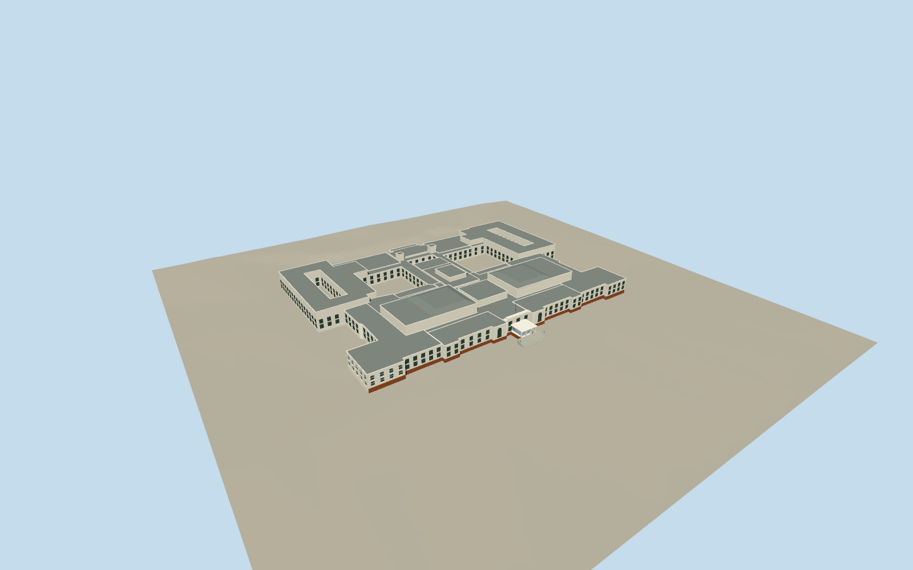

# Old Parliament House (Canberra)

Stripped classical parliamentary building with stepped white low ranges, tall paired chamber roof masses, central hall, four open courtyards, eighteen recessed white double-hung southeast-corner sash windows, other retained framed windows, round-arched north openings, balcony rails and central open entrance canopy with broad steps.

Authoring state: **review-in-qa.json**. Current completion evidence is in [qa.json](qa.json) and the [local 100 ledger](../../../../qualla-structures/batches/PROGRESS.md).

- [Old Parliament House, Canberra](https://qualla.com/old-parliament-house-canberra/)

Current southeast-corner construction uses exact native6480x4320Dhx1own-photo CC0originals001/002and native detail after Qualla-first68candidate/metadata scan. Eighteen real sash pockets on two corner pavilion faces with white closed staggered sash/glass/sills; unsupported central vertical bars and duplicated corner rails removed. Earlier attribution/private/aerial controls excluded. Full fixed main building/low wings/portico/four courtyards/roof retained pending broader fidelity review. Mapped8–14m parts, dimensions, profiles, closed sash positions/material type and present condition remain estimates, not survey certification.

Preserves four mapped open courtyards and original main building/own entrance scope. Detached garden buildings, lawn installations, temporary exhibition banners, trees and interiors excluded. Shield relief is simplified and readable heraldic lettering omitted. New painted-sash material finish is an estimate from the visible white finish. Original three lower geometry streams and all other outside attributes exact; conservative LODerror estimates.8/.4/.3m account for new recess/profile changes without measured geometric-error certification.

Independent official ACT2020 LiDAR-derived2m contours replace rejected Terrarium after initial geometry;original fields and identities retained. Source heights are unchanged. Provider smoothing and contour interpolation can miss steps/local breaks;this is not a1m raster or floor survey.

Bounded source-relative geographic preview with generic-footprint replacement disabled. Other host terrain needs contact review. No photographic pixels redistributed;no measured survey or physical-device performance claim.

Build: `node packages/worldgen/scripts/generate-authored-places.mjs --ids=old_parliament_house_canberra`. Add `--check` to verify exact regeneration. 54054 triangles; 6 materials; no embedded photographs.
