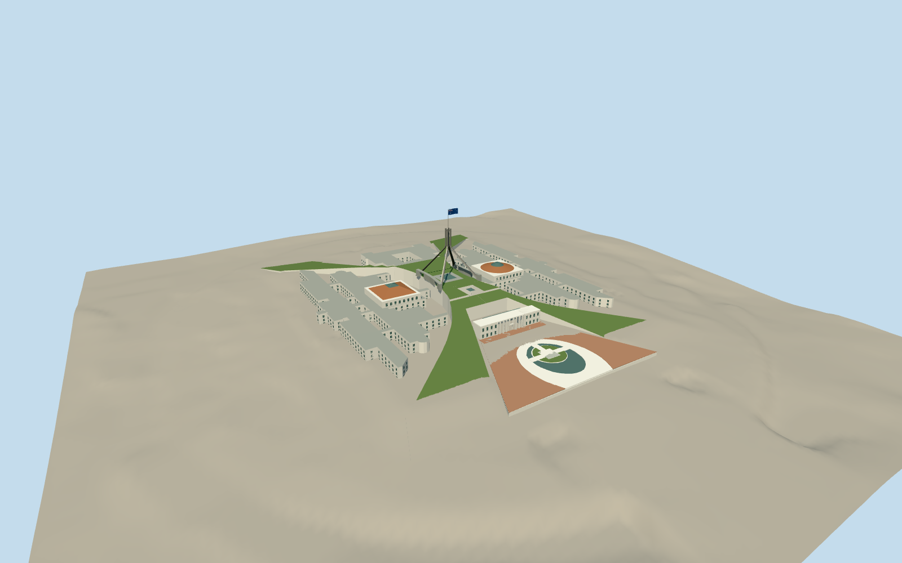

# Parliament House (Canberra)

Paired office/chamber wings with courts, curved retaining walls and grass-covered ramp roofs, round Senate and angular House chamber skylight roofs, open white marble north entrance, central glass skylights and four curved steel flag-mast legs with tall uprights and Australian flag. Published native forecourt plan retains three asymmetric water patches, connecting bridges, planted island beds and a plain mosaic square.

Authoring state: **review-in-qa.json**. Current completion evidence is in [qa.json](qa.json) and the [local 100 ledger](../../../../qualla-structures/batches/PROGRESS.md).

- [Parliament House, Canberra](https://qualla.com/parliament-house-canberra/)

Current visual references are exact creator-released public-domain2006roof-side/forecourt originals and a2010distant silhouette original. Earlier CC-BY-SA photographs,rights-unverified/copyrighted aerials and engineering illustrations are excluded. OSM vectors and primary architecture/construction/flag-mast text facts remain controls. Office elevations,court details,roof grades and partly hidden joins are estimates,not a survey.

Architectural grass roofs are real sloping model geometry. Original ends/grades remain estimates. Original ACT2020two-metre contour elevations replace rejected coarse Terrarium without fitting architecture or source heights;native data smoothing is retained. Exact AHD floor/roof grades are not surveyed.

Four narrow office courts on each side and executive court remain open. Original OSM water/pedestrian/grass vertices control the flared forecourt,asymmetric three-part basin,bridges and planted island. Public-domain2006forecourt photo confirms the pool/curb/open entrance topology. The196m²mosaic is a plain14m square;painting omitted. Basin depths remain exterior estimates. Fine rooftop plant,interiors,detached buildings,roads,security furniture and temporary objects excluded.

Primary text establishes real parking below the forecourt/pool. Only a bounded exterior deck/support envelope within the mapped paving is represented. Hidden slab,floor and wall dimensions are estimates declared before geometry,not surveyed garage levels or dimensions inferred from entry clearance,project-wide excavation or DEM. Street/close levels have a hollow shell;coarse levels simplify its concealed volume. Actual parking grid,ramps and navigable interior are excluded.

Flag top is81m above an estimated20m roof deck, based on the Parliamentary Services maintenance account. Curved leg profiles, connection details and simplified flag graphics are estimates; no structural engineering claim.

Bounded source-relative placement;the retained[-7,128]nominal forecourt reference yields596mAHD from original ACTcontours,not an independently surveyed deck elevation. Source terrain can interpolate beneath structural decks. Another live host field needs its own contact review. Footprint replacement disabled;no physical-device performance claim.

Build: `node packages/worldgen/scripts/generate-authored-places.mjs --ids=parliament_house_canberra`. Add `--check` to verify exact regeneration. 54197 triangles; 6 materials; no embedded photographs.
