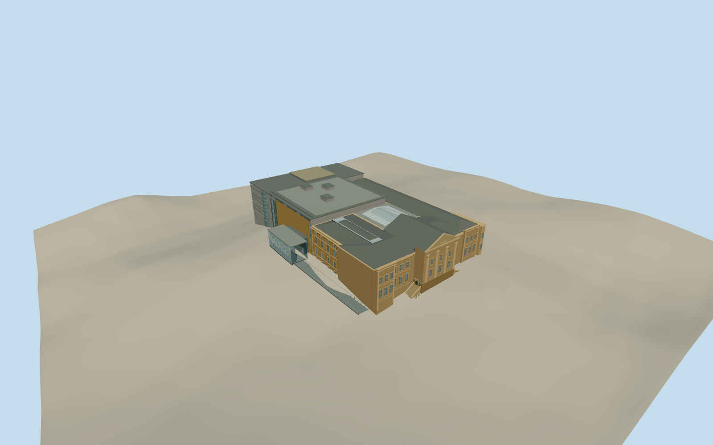

# Australian Museum, Sydney

The Australian Museum on College and William Streets, with the Barnet sandstone front, Lewis and Vernon wings, Parkes Farmer and research blocks, and Crystal Hall’s diamond glazing.

Authoring state: **review-in-qa.json**. Current completion evidence is in [qa.json](qa.json) and the [completion ledger](../../../../qualla-structures/batches/qualla-003.PROGRESS.md).

- [Australian Museum](https://qualla.com/australian-museum/)

Standing post-2020 exterior at College and William Streets. The map determines the building perimeter. Cornice, gable, internal wing divisions, roof appurtenances, old window and relief details, and exact site grade have reconstructed dimensions.

The nearly 20 by 8 m Crystal Hall and 4.5 m Museum Walk follow the design and published perimeter. The translucent diamond colors and steel framing are geometric approximations to the cleared architectural image. The known decorative artwork on other modern walls is outside the geometric reconstruction.

The frozen 256 m original site elevation field is used for terrain review. Modern foundations and lower wings follow its falling grade east and north with estimated footing depths. The model includes the mapped linked museum block. Adjacent Sydney Grammar School and detached structures are outside the exterior scope.

Build: `node content/worldgen/source/places/r3/r3g/australian_museum/models/generate-australian-museum.mjs`. Add `--check` to verify exact regeneration. 16443 triangles; 6 materials; no embedded photographs.
