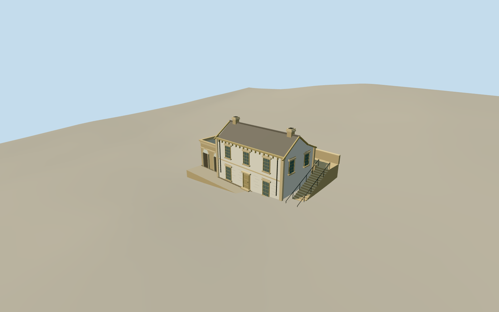

# Cadmans Cottage

Small whitewashed Georgian sandstone cottage with three-bay two-storey east facade, raised west doorway under a broken-back shingle roof, two end chimneys, ochre sash frames and a lower bare-sandstone southern annex with two tall arched doors.

Authoring state: **review-in-qa.json**. Current completion evidence is in [qa.json](qa.json) and the [local 100 ledger](../../../../qualla-structures/batches/PROGRESS.md).

- [Cadmans Cottage](https://qualla.com/cadmans-cottage/)

Front construction uses the exact archived 2009 Julioenrekei original and its contemporaneous uploader-authored public-domain release: muted weathered shingles, separate dark annex slate, front sash patterns, stone plinth and narrow flagging edge. The mismatched 2013 Qualla overwrite, earlier attribution-licensed front/rear photographs and copyrighted plan illustrations are excluded. Dimensions, concealed details and rear elevations remain estimates.

Cottage, southern annex, rear court and immediate paving/stair only. Neighboring Sailors Home, public stair farther north, historic shoreline, interiors, trees and furnishings excluded.

Rear sandstone paving and 1.2m retaining-wall height follow conservation-report text; court depth follows an interpreted offset from the independently mapped rear footpath. The 20-riser private connector, paving levels and wall foundations are interpreted exterior construction. Native terrain is coarse and cannot establish exact terrace or AHD doorway levels. No terrain values or original floor levels are changed. Footprint replacement disabled; source photos are not redistributed.

Fine stone wear, lintel inscriptions and plaque lettering omitted; glazing bars, stone bands, chimneys and timber roof details simplified by distance.

Build: `node packages/worldgen/scripts/generate-authored-places.mjs --ids=cadmans_cottage`. Add `--check` to verify exact regeneration. 2786 triangles; 8 materials; no embedded photographs.
