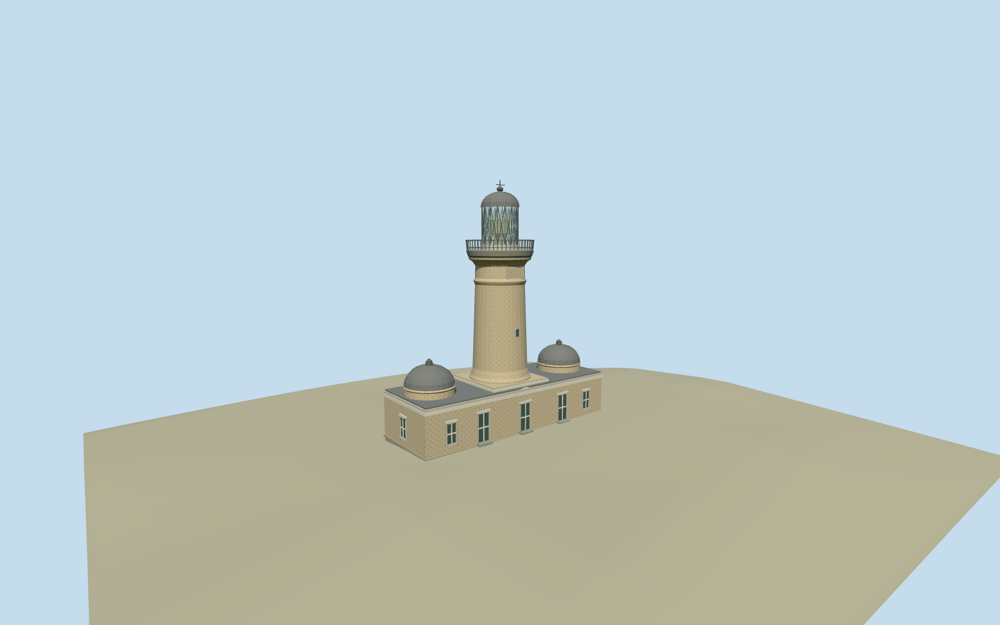

# Macquarie Lighthouse

Sydney’s 1883 Macquarie Lighthouse with white tapered stone tower, twin leaded domes and diamond-glazed Chance lantern.

Authoring state: **review-in-qa.json**. Current completion evidence is in [qa.json](qa.json) and the [completion ledger](../../../../qualla-structures/batches/qualla-004.PROGRESS.md).

- [Macquarie Lighthouse](https://qualla.com/macquarie-lighthouse/)

The nearby keepers’ cottages, original Greenway tower site, and compound walls are outside the connected Barnet building. Small optic, vents, hardware and minor paint details are simplified.

Build: `node content/worldgen/source/places/r3/r3g/macquarie_lighthouse/models/generate-macquarie-lighthouse.mjs`. Add `--check` to verify exact regeneration. 8217 triangles; 6 materials; no embedded photographs.
