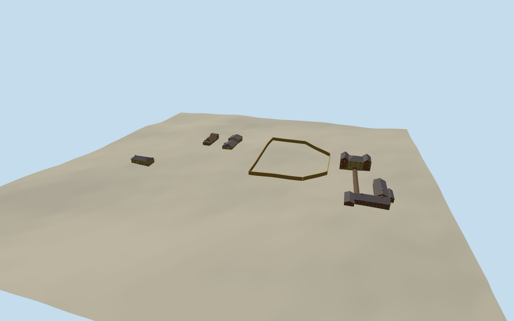

# Parramatta Female Factory and Institutions Precinct

The standing Parramatta Female Factory sandstone ranges and penitentiary enclosure, and the adjoining former school’s Georgian center, Victorian wings and covered passage.

Authoring state: **review-in-qa.json**. Current completion evidence is in [qa.json](qa.json) and the [completion ledger](../../../../qualla-structures/batches/qualla-003.PROGRESS.md).

- [Parramatta Female Factory and Institutions Precinct](https://qualla.com/parramatta-female-factory-and-institutions-precinct/)

The model represents the standing central heritage exteriors and the connecting school range. It depicts the original prison site and the later orphan school and Girls Home in their surviving form.

The southwest range footprint also includes adjoining courtyard fabric. Roof pitches, bay divisions, later additions and surface detailing are estimates derived from the written descriptions and plan geometry.

The principal dormitory footprint was registered from the official conservation plan using mapped neighbors. Fixture locations, façade openings, wall footings and foundation elevations remain approximate.

The independent ground samples are unchanged. They capture the river terrace broadly and do not provide surveyed floor levels.

Build: `node content/worldgen/source/places/r3/r3g/parramatta_female_factory_and_institutions_precinct/models/generate-parramatta-precinct.mjs`. Add `--check` to verify exact regeneration. 10446 triangles; 6 materials; no embedded photographs.
