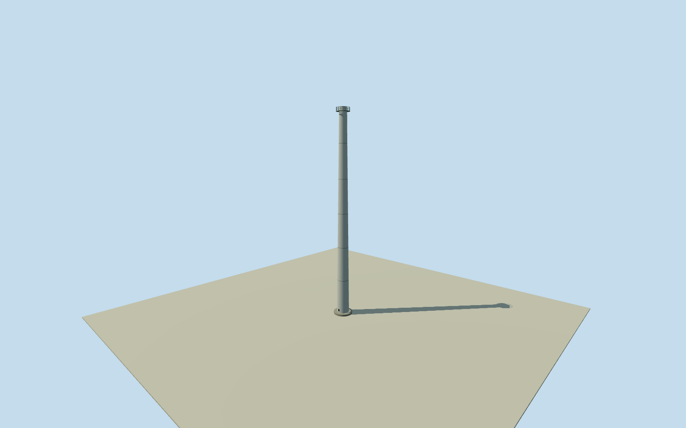

# Olympic Dam anode furnace stack

Whole independently named1997pre-expansion anode-furnace exhaust stack, full60m outside shell/closedfoundation/open1.37m inside outlet/estimated access andmaintenance details. Identicaltype reused atboth originalnumericaltablepositions. No whole-mine/shaft-headframe or proposed80mstack proxy. Provisional UTM53S/WGS84 conversion of original679169E/6630054N; source datum unknown, nominal300m registration allowance is not a measured error bound. No modern-survival claim. Radius/taper/material/finish/platform/access/support/ground contact remain original estimates; no source imagery used. Original operator1997TableL.7 existing-column60m height and1.37m INTERNAL outlet diameter retained, distinct from proposed80m changes. Both original table points retained as two instances of one otherwise-identical stack. Approximate1997date/current-world eligiblefalse; subsequent survival/alteration unverified. Source coordinate datum not established. Original679169E/6630054N and679139E/6630054N are provisionally interpreted as UTM53south on WGS84, without photo/map/survey fitting. Nominal300m horizontal allowance is not a measured error bound; no claim of surveyed registration. Circular facing/access180deg estimated. Original exterior interpretation: plain light-gray painted steel tapered shell, estimated radius1.8m atbase/1.1m attop, circular concretefoundation, topmaintenance ring/guardrails, closedsmallinspection hatch and external ladder. The material, outerradius/taper, platform, collar/access placement, exact1997condition andsupport details are not observed; outerradius uncertainty1m/components1m/height2m. No logo, plume, processbuilding or buried/internal equipment. Short1m innerbore anddark occlusioncap are visualization simplifications, not internal routing. Own256m129x129/16641-height field/2rawtiles/datum106.8613m fixed before floor.15m/foundation-.5..+.15m/shelltop60.15m. Sourcegrade/contact approximate; no surveyedverticaltie. Originalfield/frame/floor/mainsections must remain unmasked/unflattened/unfitted. Qualla first9candidates/0conflicts. Existing orbital photos/geological diagram do not establish architecture and are unused. Every source photograph/plan/figure/diagram andimage-derivedappearance unused; originaloperatorwritten/numericalfacts only. Complete physicalstack type/twoplacements, not wholeOlympicDam site or a mineheadframe proxy.

Authoring state: **review-in-qa.json**. Current completion evidence is in [qa.json](qa.json) and the [completion ledger](../../../../qualla-structures/batches/qualla-002.PROGRESS.md).

- [Olympic Dam mine](https://qualla.com/olympic-dam-mine/)

Whole independently named1997pre-expansion anode-furnace exhaust stack, full60m outside shell/closedfoundation/open1.37m inside outlet/estimated access andmaintenance details. Identicaltype reused atboth originalnumericaltablepositions. No whole-mine/shaft-headframe or proposed80mstack proxy. Provisional UTM53S/WGS84 conversion of original679169E/6630054N; source datum unknown, nominal300m registration allowance is not a measured error bound. No modern-survival claim. Radius/taper/material/finish/platform/access/support/ground contact remain original estimates; no source imagery used.

Original operator1997TableL.7 existing-column60m height and1.37m INTERNAL outlet diameter retained, distinct from proposed80m changes. Both original table points retained as two instances of one otherwise-identical stack. Approximate1997date/current-world eligiblefalse; subsequent survival/alteration unverified.

Source coordinate datum not established. Original679169E/6630054N and679139E/6630054N are provisionally interpreted as UTM53south on WGS84, without photo/map/survey fitting. Nominal300m horizontal allowance is not a measured error bound; no claim of surveyed registration. Circular facing/access180deg estimated.

Original exterior interpretation: plain light-gray painted steel tapered shell, estimated radius1.8m atbase/1.1m attop, circular concretefoundation, topmaintenance ring/guardrails, closedsmallinspection hatch and external ladder. The material, outerradius/taper, platform, collar/access placement, exact1997condition andsupport details are not observed; outerradius uncertainty1m/components1m/height2m. No logo, plume, processbuilding or buried/internal equipment. Short1m innerbore anddark occlusioncap are visualization simplifications, not internal routing.

Own256m129x129/16641-height field/2rawtiles/datum106.8613m fixed before floor.15m/foundation-.5..+.15m/shelltop60.15m. Sourcegrade/contact approximate; no surveyedverticaltie. Originalfield/frame/floor/mainsections must remain unmasked/unflattened/unfitted.

Qualla first9candidates/0conflicts. Existing orbital photos/geological diagram do not establish architecture and are unused. Every source photograph/plan/figure/diagram andimage-derivedappearance unused; originaloperatorwritten/numericalfacts only. Complete physicalstack type/twoplacements, not wholeOlympicDam site or a mineheadframe proxy.

Build: `node content/worldgen/source/places/r4/r49/olympic_dam_anode_furnace_stack/models/generate-house.mjs`. Add `--check` to verify exact regeneration. 5550 triangles; 4 materials; no embedded photographs.
