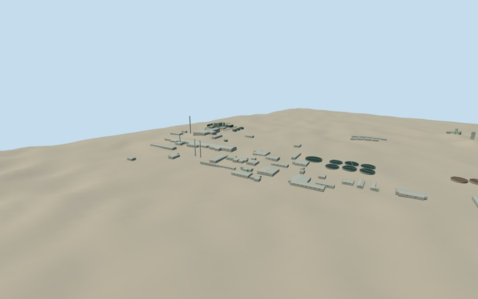

# Olympic Dam mine

A medium-fi surface reconstruction with86independent assets at87existing geographic placements. It retains all79original mapped building/process-body outlines, four shaft-surface structures and three stack assets at four separate locations. The pair of historical anode furnace stacks reuses one geometry at its two source-table positions. There is no aggregate mine GLB or new site-centroid building placement.

All individual geometries, original terrain fields, floor levels, main sections and QA remain unchanged. Their already-cleared Qualla NASA references and original numerical/written sources are preserved. The1997table identifies existing pre-expansion stacks, and its proposed replacement heights were not adopted. The2024lit stack uses separate aeronautical control. Exact modern process-stack correspondence, historic/current continuity and hidden equipment details remain estimates.

The new assembly ground field spans3328m and uses16original Terrarium tiles:12were cached and4coarse elevation tiles were retrieved. It is not a surveyed mine platform. Individual vertical registration and source coordinate-datum uncertainties remain as documented in each model. Four assembly views were inspected, including a closer central-plant view. The viewer retains independent date-qualified member placements; the composite is not certified as one simultaneous as-built state.

This completes the requested best-effort exterior model using the available terrain, cleared pictures and numerical facts. It does not claim an engineering equipment register, buried workings or the surrounding township and airport. No new appearance imagery, old-model reconstruction, individual rerendering or rights revalidation was performed.

[Qualla story](https://qualla.com/olympic-dam-mine/)

Regenerate the assembly scene with `node content/worldgen/source/places/r4/r49/olympic_dam_mine/generate-collection-scene.mjs`; `--check` verifies the frozen existing inputs without rebuilding member geometry.
