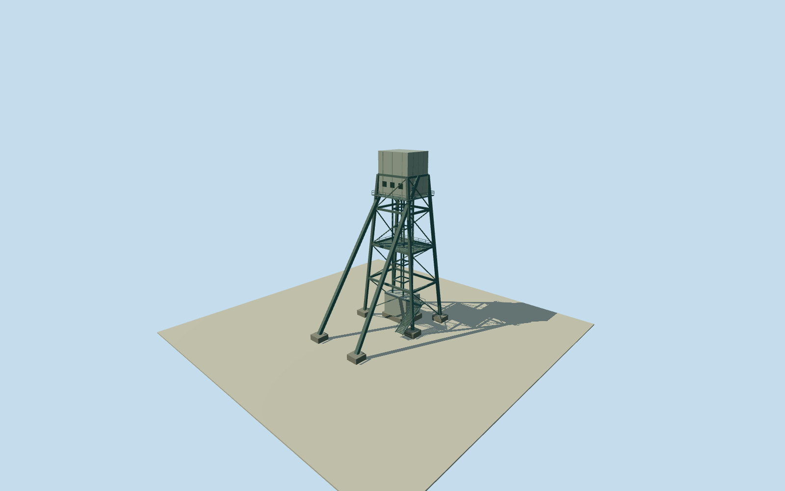

# Olympic Dam northern east shaft structure

One complete aboveground shaft surface structure at the eastern of the three northern anonymous shaft points. Nearby free-standing buildings, conveyors, other shafts and plant equipment remain separate. Original anonymous numerical shaft point remains fixed. Cleared published NASA ISS038-E-29810 first, then existing ISS038-E-29809. Broad pale upper mass and tall darker surface structure support an original estimated shaft surface reconstruction, not a surveyed or named headframe. Complete aboveground model, with exact structural topology, footprint, height, heading, materials, equipment, date continuity and vertical tie explicitly unmeasured. Nominal30m horizontal/25m height and component allowances are estimates, not measured error bounds. No photograph texture, report graphic, questionable image or underground-depth-as-height inference. Whole independent aboveground shaft surface reconstruction at original anonymous node1965266963. Estimated tapered steel support, two inclined backstays, central guide frame, upper machinery enclosure, lower collar enclosure, six independent concrete support pads and near-level access platforms. Other separate buildings, shafts, conveyors and mine structures remain separate. Named shaft identity and exact aboveground structural topology remain unverified; this is not a surveyed headframe reconstruction. Initial floor0.25m/foundation-1.2m; main support39.25m, upper enclosure34.25..45.25m, lower enclosure0.25..6.25m; 45m top above floor. All dimensions, topology, sections, facing, materials and access equipment are original estimates from broad coarse2014NASA context. No underground depth adopted as aboveground height and no measured shadow-height claim. Nominal30m horizontal/25m height and component allowances are estimates, not measured error bounds. Original published Qualla NASA ISS038-E-29810 inspected first; existing published ISS038-E-29809 gives the second view. Both exact original image bytes and native NASA JSC ESRS public-domain releases bound. No photographic texture, report graphic or questionable appearance source. Original point/road-context association is broad, not surveyed photo registration. Exact2014-to2026 continuity unverified. Historical2014preview/currentWorldEligiblefalse. Own512m129x129/16641height source field and four original tiles acquired before initial floor/main sections. Frame, field, floor and main sections now frozen; no masking, flattening, ground cutout or geometry fitting. Composite grade can disagree with support pads; no surveyed vertical tie. Four complete authoredLODs retain whole upper/lower housings, main support, backstays, central guide and independent foundations. District adds intermediate structural members; street/closeup add bracing, platforms, estimated rails, stairs and small housing divisions. No exposed moving machinery, named hoist or exact equipment census claimed.

Authoring state: **review-in-qa.json**. Current completion evidence is in [qa.json](qa.json) and the [completion ledger](../../../../qualla-structures/batches/qualla-002.PROGRESS.md).

- [Olympic Dam mine](https://qualla.com/olympic-dam-mine/)

One complete aboveground shaft surface structure at the eastern of the three northern anonymous shaft points. Nearby free-standing buildings, conveyors, other shafts and plant equipment remain separate. Original anonymous numerical shaft point remains fixed. Cleared published NASA ISS038-E-29810 first, then existing ISS038-E-29809. Broad pale upper mass and tall darker surface structure support an original estimated shaft surface reconstruction, not a surveyed or named headframe. Complete aboveground model, with exact structural topology, footprint, height, heading, materials, equipment, date continuity and vertical tie explicitly unmeasured. Nominal30m horizontal/25m height and component allowances are estimates, not measured error bounds. No photograph texture, report graphic, questionable image or underground-depth-as-height inference.

Whole independent aboveground shaft surface reconstruction at original anonymous node1965266963. Estimated tapered steel support, two inclined backstays, central guide frame, upper machinery enclosure, lower collar enclosure, six independent concrete support pads and near-level access platforms. Other separate buildings, shafts, conveyors and mine structures remain separate. Named shaft identity and exact aboveground structural topology remain unverified; this is not a surveyed headframe reconstruction.

Initial floor0.25m/foundation-1.2m; main support39.25m, upper enclosure34.25..45.25m, lower enclosure0.25..6.25m; 45m top above floor. All dimensions, topology, sections, facing, materials and access equipment are original estimates from broad coarse2014NASA context. No underground depth adopted as aboveground height and no measured shadow-height claim. Nominal30m horizontal/25m height and component allowances are estimates, not measured error bounds.

Original published Qualla NASA ISS038-E-29810 inspected first; existing published ISS038-E-29809 gives the second view. Both exact original image bytes and native NASA JSC ESRS public-domain releases bound. No photographic texture, report graphic or questionable appearance source. Original point/road-context association is broad, not surveyed photo registration. Exact2014-to2026 continuity unverified. Historical2014preview/currentWorldEligiblefalse.

Own512m129x129/16641height source field and four original tiles acquired before initial floor/main sections. Frame, field, floor and main sections now frozen; no masking, flattening, ground cutout or geometry fitting. Composite grade can disagree with support pads; no surveyed vertical tie.

Four complete authoredLODs retain whole upper/lower housings, main support, backstays, central guide and independent foundations. District adds intermediate structural members; street/closeup add bracing, platforms, estimated rails, stairs and small housing divisions. No exposed moving machinery, named hoist or exact equipment census claimed.

Build: `node content/worldgen/source/places/r4/r49/olympic_dam_northern_east_shaft_structure/models/generate-house.mjs`. Add `--check` to verify exact regeneration. 2964 triangles; 4 materials; no embedded photographs.
