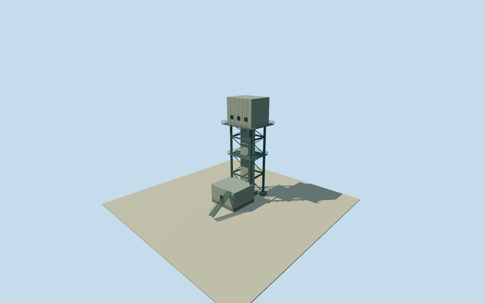

# Olympic Dam northern middle shaft structure

One complete aboveground surface structure at the middle/southern of the three northern anonymous shaft points. Neighboring shaft assemblies and separate buildings remain separate. Original anonymous numerical shaft point remains fixed. Published Qualla NASA ISS038-E-29810 first, then existing ISS038-E-29809. Broad compact upper box/darker vertical body context supports an original estimated shaft surface tower, not a surveyed or named headframe. Complete estimated aboveground form, with exact topology/type, footprint, height, facing, materials, machinery, access, date continuity and vertical tie unmeasured. Nominal40m horizontal/20m height and component allowances are estimates, not measured bounds. No photograph texture, report graphic, questionable source, exposed machinery claim or underground-depth-as-height inference. Whole estimated aboveground surface structure at anonymous shaft node1965267029: closed narrow vertical core, enlarged upper housing, four straight external support columns, upper/mid maintenance decks, attached low housing and connecting lower box, separate foundations and estimated access equipment. Exact structural type/topology and named shaft identity remain unverified. No northern east backstay clone, western process-assembly clone or exposed sheave/fan machinery claim. Initial floor0.25m/foundation-1.2m; core top30.25m, upper enclosure28.25..38.25m, frame top28.25m, middeck16.25m, attached housing top6.25m and connecting lower box top4.25m. All footprint, component positions, sections, height, facing, exact topology, materials and access equipment are original medium-fi estimates. Nominal40m horizontal/20m height and component allowances are not measured error bounds. No underground depth or measured shadow height used. Published Qualla NASA ISS038-E-29810 first; existing published ISS038-E-29809 second. Both exact local original bytes and native NASA JSC mission/roll/frame/public-domain releases bound. Broad compact upper mass/darker vertical-body context only; no measured pixel-to-point registration or plan tracing. No photograph texture, report graphic or questionable appearance source.2014-to2026 continuity unverified; historical2014preview/currentWorldEligiblefalse. Own original512m129x129/16641height field and two original tiles acquired before floor/main sections. Original point/frame/field/floor/main sections frozen. No mask, flattening, fitting, ground cutout or surveyed vertical tie. Coarse composite grade can disagree with foundations and low attached housing. Four complete authored levels retain core, upper housing, four supports, low housing/connector, foundations and upper/mid deck silhouettes. District restores intermediate framework/bracing; street/closeup add rails, connected access stair/ladder, closed service panels and housing divisions. All equipment details are estimates; no transparent machinery interior.

Authoring state: **review-in-qa.json**. Current completion evidence is in [qa.json](qa.json) and the [completion ledger](../../../../qualla-structures/batches/qualla-002.PROGRESS.md).

- [Olympic Dam mine](https://qualla.com/olympic-dam-mine/)

One complete aboveground surface structure at the middle/southern of the three northern anonymous shaft points. Neighboring shaft assemblies and separate buildings remain separate. Original anonymous numerical shaft point remains fixed. Published Qualla NASA ISS038-E-29810 first, then existing ISS038-E-29809. Broad compact upper box/darker vertical body context supports an original estimated shaft surface tower, not a surveyed or named headframe. Complete estimated aboveground form, with exact topology/type, footprint, height, facing, materials, machinery, access, date continuity and vertical tie unmeasured. Nominal40m horizontal/20m height and component allowances are estimates, not measured bounds. No photograph texture, report graphic, questionable source, exposed machinery claim or underground-depth-as-height inference.

Whole estimated aboveground surface structure at anonymous shaft node1965267029: closed narrow vertical core, enlarged upper housing, four straight external support columns, upper/mid maintenance decks, attached low housing and connecting lower box, separate foundations and estimated access equipment. Exact structural type/topology and named shaft identity remain unverified. No northern east backstay clone, western process-assembly clone or exposed sheave/fan machinery claim.

Initial floor0.25m/foundation-1.2m; core top30.25m, upper enclosure28.25..38.25m, frame top28.25m, middeck16.25m, attached housing top6.25m and connecting lower box top4.25m. All footprint, component positions, sections, height, facing, exact topology, materials and access equipment are original medium-fi estimates. Nominal40m horizontal/20m height and component allowances are not measured error bounds. No underground depth or measured shadow height used.

Published Qualla NASA ISS038-E-29810 first; existing published ISS038-E-29809 second. Both exact local original bytes and native NASA JSC mission/roll/frame/public-domain releases bound. Broad compact upper mass/darker vertical-body context only; no measured pixel-to-point registration or plan tracing. No photograph texture, report graphic or questionable appearance source.2014-to2026 continuity unverified; historical2014preview/currentWorldEligiblefalse.

Own original512m129x129/16641height field and two original tiles acquired before floor/main sections. Original point/frame/field/floor/main sections frozen. No mask, flattening, fitting, ground cutout or surveyed vertical tie. Coarse composite grade can disagree with foundations and low attached housing.

Four complete authored levels retain core, upper housing, four supports, low housing/connector, foundations and upper/mid deck silhouettes. District restores intermediate framework/bracing; street/closeup add rails, connected access stair/ladder, closed service panels and housing divisions. All equipment details are estimates; no transparent machinery interior.

Build: `node content/worldgen/source/places/r4/r49/olympic_dam_northern_middle_shaft_structure/models/generate-house.mjs`. Add `--check` to verify exact regeneration. 2556 triangles; 4 materials; no embedded photographs.
