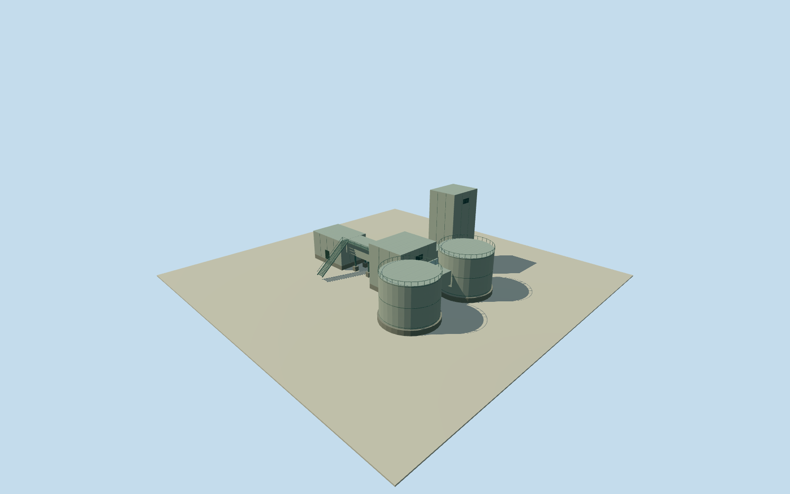

# Olympic Dam northern west shaft structure

One complete connected aboveground surface assembly at the western of the three northern anonymous shaft points. Nearby separate buildings, other shafts and unrelated plant equipment remain separate. Original anonymous numerical shaft point remains fixed. Existing published Qualla NASA ISS038-E-29810 first, then ISS038-E-29809. Broad multi-part box/rounded-housing morphology only. Complete estimated connected surface assembly; exact aboveground type, functional identity, shaft name, topology, footprint, height, facing, materials, access, date continuity and vertical tie remain unverified. Nominal40m horizontal/20m height and component allowances are estimates, not measured bounds. No headframe clone, photograph texture, report graphic, questionable appearance source or underground-depth-as-height inference. Complete estimated connected surface assembly at anonymous shaft node1965266853. Three box-like housings, two eastern rounded housings, horizontal connecting galleries/plenums, separate concrete foundations/support pads and estimated maintenance access. The broad multi-part surface morphology is inferred from two coarse original NASA views; exact headgear, ventilation or other functional identity is unverified. No exposed fan blades, named shaft or moving machinery claimed. Other separate mine buildings and shafts remain separate. Initial floor0.25m/foundation-1.2m. Central housing top12.25m, northern housing top23.25m, western housing top8.25m and rounded housing tops11.25m. All footprint, component positions/census, exact structural topology, sections, heights, materials, heading and access equipment are original medium-fi estimates. Nominal40m horizontal/20m height and component allowances are not measured error bounds. No headframe clone or shaft depth used as an aboveground height. Already-published Qualla NASA ISS038-E-29810 first; existing published ISS038-E-29809 second. Exact image bytes and native NASA JSC ESRS mission/roll/frame PD releases bound for both. No photograph texture, report graphic or questionable image. Original anonymous point/road-context association only; no surveyed image registration or measured pixel-to-footprint transform. Exact2014-to2026 continuity unverified. Historical2014preview/currentWorldEligiblefalse. Own original512m129x129/16641height field and two original Terrarium tiles acquired before initial floor/main sections. Original point/frame, field, floor and main sections frozen; no masking, flattening, fitting, ground cutout or vertical tie claim. Coarse composite grade may disagree with housing foundations and elevated gallery support pads. All four authored levels retain every main box housing, both rounded housings, all three connecting galleries, foundations and gallery supports. District adds housing and vessel divisions; street/closeup add service panels, railings, maintenance deck and access stair. All openings are closed dark panels; no invented transparent machinery interiors.

Authoring state: **review-in-qa.json**. Current completion evidence is in [qa.json](qa.json) and the [completion ledger](../../../../qualla-structures/batches/qualla-002.PROGRESS.md).

- [Olympic Dam mine](https://qualla.com/olympic-dam-mine/)

One complete connected aboveground surface assembly at the western of the three northern anonymous shaft points. Nearby separate buildings, other shafts and unrelated plant equipment remain separate. Original anonymous numerical shaft point remains fixed. Existing published Qualla NASA ISS038-E-29810 first, then ISS038-E-29809. Broad multi-part box/rounded-housing morphology only. Complete estimated connected surface assembly; exact aboveground type, functional identity, shaft name, topology, footprint, height, facing, materials, access, date continuity and vertical tie remain unverified. Nominal40m horizontal/20m height and component allowances are estimates, not measured bounds. No headframe clone, photograph texture, report graphic, questionable appearance source or underground-depth-as-height inference.

Complete estimated connected surface assembly at anonymous shaft node1965266853. Three box-like housings, two eastern rounded housings, horizontal connecting galleries/plenums, separate concrete foundations/support pads and estimated maintenance access. The broad multi-part surface morphology is inferred from two coarse original NASA views; exact headgear, ventilation or other functional identity is unverified. No exposed fan blades, named shaft or moving machinery claimed. Other separate mine buildings and shafts remain separate.

Initial floor0.25m/foundation-1.2m. Central housing top12.25m, northern housing top23.25m, western housing top8.25m and rounded housing tops11.25m. All footprint, component positions/census, exact structural topology, sections, heights, materials, heading and access equipment are original medium-fi estimates. Nominal40m horizontal/20m height and component allowances are not measured error bounds. No headframe clone or shaft depth used as an aboveground height.

Already-published Qualla NASA ISS038-E-29810 first; existing published ISS038-E-29809 second. Exact image bytes and native NASA JSC ESRS mission/roll/frame PD releases bound for both. No photograph texture, report graphic or questionable image. Original anonymous point/road-context association only; no surveyed image registration or measured pixel-to-footprint transform. Exact2014-to2026 continuity unverified. Historical2014preview/currentWorldEligiblefalse.

Own original512m129x129/16641height field and two original Terrarium tiles acquired before initial floor/main sections. Original point/frame, field, floor and main sections frozen; no masking, flattening, fitting, ground cutout or vertical tie claim. Coarse composite grade may disagree with housing foundations and elevated gallery support pads.

All four authored levels retain every main box housing, both rounded housings, all three connecting galleries, foundations and gallery supports. District adds housing and vessel divisions; street/closeup add service panels, railings, maintenance deck and access stair. All openings are closed dark panels; no invented transparent machinery interiors.

Build: `node content/worldgen/source/places/r4/r49/olympic_dam_northern_west_shaft_structure/models/generate-house.mjs`. Add `--check` to verify exact regeneration. 5284 triangles; 4 materials; no embedded photographs.
