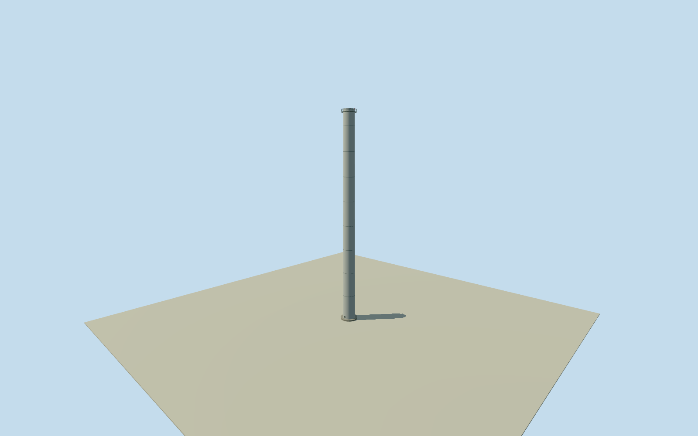

# Olympic Dam northwestern smelter stack

Whole single lit smelter-stack obstacle in the original2024Airservices record, at its rounded navigational locus. Process identity, exact physical location, AGLheight, shell section, fittings and historic ground tie remain estimates. Other stacks/buildings and whole mine remain separate. No1997coordinate transfer, nearest-roof selection, image fit or claimed main/acidprocess identity. Original634ftAMSL top is not an AGLheight. Every appearance image unused after Qualla-first screening. Original2024published634ftAMSL/193.2432m stack-top elevation is not a measured AGLheight. Initial localfloor.15m and an approximate vertical tie to the independently acquired composite-ground datum106.5566m give nominal shellheight86.53659999999999m. AIPAMSL and source-ground datum/terrain sampling are not surveyed together. Nominal12m height allowance is an estimate, not a measured error bound. Airport elevation is never subtracted from the stack top. Original335degMAG/4500m range plus published7degE variation gives342degtrue. The WGS84ellipsoid direct solution fixes a coarse navigational locus before terrain/floor/sections. Nominal100m horizontal allowance is not a measured confidence bound. No relocation, nearest-roof assignment, source-coordinate or image fit. Individual process identity remains unverified: do not label this as the main-smelter or acid-plant stack by proximity or top elevation. The two543ft obstacles are separate, not positioned or duplicated by this asset. Historical1997stackassets and proposed upgrades are neither reused nor silently promoted to this2024state. Shell radii2.6m atbase/2.2m attop,3.2m inneroutlet diameter, taper, paintedsteelfinish, foundation, maintenance ring/rails/ladder/collars/closedinspectioncover and obstruction-lightfixture cue are original estimates. The light color and mounting are unverified; no operating flashing behavior claimed. No borrowed photograph, plume, logo, adjoining processbuilding or buriedrouting. Short1m innerbore/darkocclusioncap is a visualization simplification. Own original256m129x129field/1rawtiles fixed before floor and mainsections. No masking, cutout, flattening, terrain-height/anchor/floor fitting or post-render section changes. Exact historic ground contact and datum tie remain unverified. Qualla-first9families/0conflicts. All appearance images unused; only original published numerical obstacle data and a transparent geodesic/datum interpretation. Whole mine and other major site structures remain unfinished.

Authoring state: **review-in-qa.json**. Current completion evidence is in [qa.json](qa.json) and the [completion ledger](../../../../qualla-structures/batches/qualla-002.PROGRESS.md).

- [Olympic Dam mine](https://qualla.com/olympic-dam-mine/)

Whole single lit smelter-stack obstacle in the original2024Airservices record, at its rounded navigational locus. Process identity, exact physical location, AGLheight, shell section, fittings and historic ground tie remain estimates. Other stacks/buildings and whole mine remain separate. No1997coordinate transfer, nearest-roof selection, image fit or claimed main/acidprocess identity. Original634ftAMSL top is not an AGLheight. Every appearance image unused after Qualla-first screening.

Original2024published634ftAMSL/193.2432m stack-top elevation is not a measured AGLheight. Initial localfloor.15m and an approximate vertical tie to the independently acquired composite-ground datum106.5566m give nominal shellheight86.53659999999999m. AIPAMSL and source-ground datum/terrain sampling are not surveyed together. Nominal12m height allowance is an estimate, not a measured error bound. Airport elevation is never subtracted from the stack top.

Original335degMAG/4500m range plus published7degE variation gives342degtrue. The WGS84ellipsoid direct solution fixes a coarse navigational locus before terrain/floor/sections. Nominal100m horizontal allowance is not a measured confidence bound. No relocation, nearest-roof assignment, source-coordinate or image fit.

Individual process identity remains unverified: do not label this as the main-smelter or acid-plant stack by proximity or top elevation. The two543ft obstacles are separate, not positioned or duplicated by this asset. Historical1997stackassets and proposed upgrades are neither reused nor silently promoted to this2024state.

Shell radii2.6m atbase/2.2m attop,3.2m inneroutlet diameter, taper, paintedsteelfinish, foundation, maintenance ring/rails/ladder/collars/closedinspectioncover and obstruction-lightfixture cue are original estimates. The light color and mounting are unverified; no operating flashing behavior claimed. No borrowed photograph, plume, logo, adjoining processbuilding or buriedrouting. Short1m innerbore/darkocclusioncap is a visualization simplification.

Own original256m129x129field/1rawtiles fixed before floor and mainsections. No masking, cutout, flattening, terrain-height/anchor/floor fitting or post-render section changes. Exact historic ground contact and datum tie remain unverified.

Qualla-first9families/0conflicts. All appearance images unused; only original published numerical obstacle data and a transparent geodesic/datum interpretation. Whole mine and other major site structures remain unfinished.

Build: `node content/worldgen/source/places/r4/r49/olympic_dam_northwestern_smelter_stack/models/generate-house.mjs`. Add `--check` to verify exact regeneration. 7194 triangles; 4 materials; no embedded photographs.
