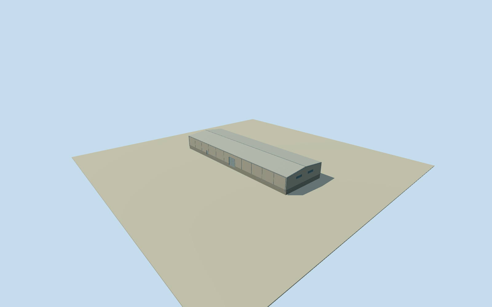

# Olympic Dam south central processing hall

Whole independently placed south central processing hall at Olympic Dam, complete original 4-corner roof footprint including the original roof perimeter, closed industrial walls/roof, foundation, estimated service entrances and upper ventilation bays. Separate plant buildings, tanks, conveyors, headframes and exhaust stacks remain separate. Already cleared published Qualla NASA ISS038-E-29810 original supplies plant-level pale metal roof and industrial context. Original 6048x4032 image and central detail inspected. Specific façade, doors, roof section, building height, exact function, current condition and exact2014-to2026 footprint continuity are unmeasured estimates. No photographic texture; no copyrighted imagery, report graphics or unverified named shaft adopted. Nominal5m horizontal and6m vertical/component uncertainty, not survey or measured bounds. Whole original4corner footprint with the complete independent roof and outer perimeter. Original NASA2014 image supports broad plant roof and pale metal finish context, not measured hall height, specific roof section or façade census. No named process function assigned. Numerical geometry retrieved2026; exact2014continuity unverified. Explicit section approximation: floor0.25m, foundation-1.2m, concreteplinth1.1m, main roof ridge8.25m with a shallow dual pitch over the full roof. Nominal north eave7m; both long eaves7m. Roof section,8mheight abovefloor, allwall/opening/support/access detail and condition unmeasured with6m nominalheight/componentallowance, not measured bounds. Two closed service entries and10upper industrialventilationbays are original estimated detail, no floor or opening census claimed. Independent512m129x129/16641height field/4rawtiles/datum106.6403m acquired before this floor/section choice. No mask, flattening, heightfield refit, frame movement or floor/roof fitting. Coarse DEM is not a foundation or roof survey; substantial local contact disagreement may remain. Four complete authoredLODs retain all4corners, closedroof/base/walls/entries/ventilationcues; near levels add physicalrecesses/blades/frames. Exactly one existing published Qualla NASA federal publicdomainoriginal; no photographictextures, otherphotos or reportgraphics. Historical2014context preview/currentworldeligiblefalse. Wholemine unfinished.

Authoring state: **review-in-qa.json**. Current completion evidence is in [qa.json](qa.json) and the [completion ledger](../../../../qualla-structures/batches/qualla-002.PROGRESS.md).

- [Olympic Dam mine](https://qualla.com/olympic-dam-mine/)

Whole independently placed south central processing hall at Olympic Dam, complete original 4-corner roof footprint including the original roof perimeter, closed industrial walls/roof, foundation, estimated service entrances and upper ventilation bays. Separate plant buildings, tanks, conveyors, headframes and exhaust stacks remain separate. Already cleared published Qualla NASA ISS038-E-29810 original supplies plant-level pale metal roof and industrial context. Original 6048x4032 image and central detail inspected. Specific façade, doors, roof section, building height, exact function, current condition and exact2014-to2026 footprint continuity are unmeasured estimates. No photographic texture; no copyrighted imagery, report graphics or unverified named shaft adopted. Nominal5m horizontal and6m vertical/component uncertainty, not survey or measured bounds.

Whole original4corner footprint with the complete independent roof and outer perimeter. Original NASA2014 image supports broad plant roof and pale metal finish context, not measured hall height, specific roof section or façade census. No named process function assigned. Numerical geometry retrieved2026; exact2014continuity unverified.

Explicit section approximation: floor0.25m, foundation-1.2m, concreteplinth1.1m, main roof ridge8.25m with a shallow dual pitch over the full roof. Nominal north eave7m; both long eaves7m. Roof section,8mheight abovefloor, allwall/opening/support/access detail and condition unmeasured with6m nominalheight/componentallowance, not measured bounds. Two closed service entries and10upper industrialventilationbays are original estimated detail, no floor or opening census claimed.

Independent512m129x129/16641height field/4rawtiles/datum106.6403m acquired before this floor/section choice. No mask, flattening, heightfield refit, frame movement or floor/roof fitting. Coarse DEM is not a foundation or roof survey; substantial local contact disagreement may remain.

Four complete authoredLODs retain all4corners, closedroof/base/walls/entries/ventilationcues; near levels add physicalrecesses/blades/frames. Exactly one existing published Qualla NASA federal publicdomainoriginal; no photographictextures, otherphotos or reportgraphics. Historical2014context preview/currentworldeligiblefalse. Wholemine unfinished.

Build: `node content/worldgen/source/places/r4/r49/olympic_dam_south_central_processing_hall/models/generate-house.mjs`. Add `--check` to verify exact regeneration. 2222 triangles; 6 materials; no embedded photographs.
