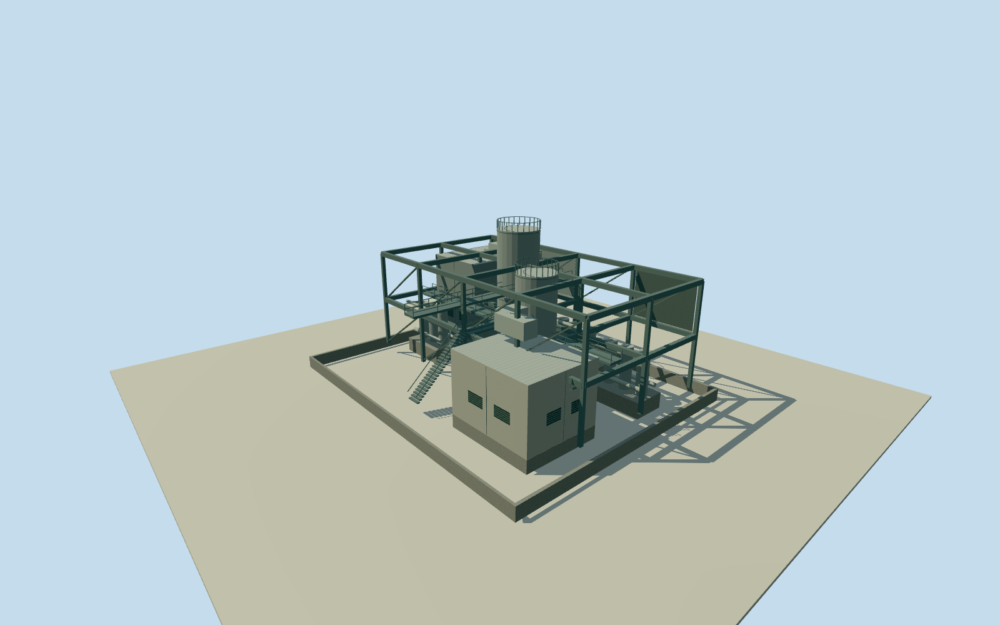

# Olympic Dam southern shaft surface structure

Only the complete central connected aboveground industrial surface body at the isolated southern anonymous shaft region. The adjacent separated pale-roofed buildings and outdoor pads remain independent, not a whole-compound composite. Original anonymous southern shaft point remains fixed. Existing published Qualla NASA ISS038-E-29810 first and ISS038-E-29809 second supply broad isolated central industrial-body context. Complete connected framework/equipment reconstruction with all footprint, height, function, shaft name, topology, equipment layout, facing, materials, access, date continuity and vertical tie explicitly estimated. Nominal60m horizontal/15m height and component allowances are not measured bounds. Adjacent detached buildings are excluded from this asset. No photograph texture, report graphic, questionable appearance source, headframe clone or underground-depth-as-height inference. Whole estimated38x30m central connected southern shaft surface body. Estimated perimeter foundation strips, independent equipment pads, complete open steel framework, two roofed equipment housings, two contained vertical vessels, duct routes and maintenance walks. Open ground between equipment remains visible; no uniform roof or site-wide building proxy. Adjacent individually mapped buildings and round vessels remain separate. Parent mine unfinished. All internal equipment layout and component census are original medium-fi estimates guided by broad original photograph arrangement, not a measured process survey. Initial floor0.25m/foundation-1.2m; frame levels6.25m and12.25m; housing tops11.25/7.25m; vessel tops16.25/13.25m. Heights and sections unmeasured. Nominal15m height/component and60m horizontal allowances are estimates, not measured error bounds. No named furnace/process identity or operating flame claimed. Pale bright module uses ordinary pale material without emission. Original published Qualla NASA ISS038-E-29810 first and existing published ISS038-E-29809 for the isolated southern central body. Both native NASA JSC ESRS mission/roll/frame public-domain releases and exact local image bytes bound. No photo texture, copyrighted report figure or other appearance source. Exact2014-to2026 footprint continuity, detailed condition and equipment identity unverified. Own independent512m129x129/16641height source field and raw source tile acquired before initial floor/main sections. Geographic frame, original field, floor and main sections frozen. No masking, flattening, roof/floor fitting or terrain cutout. Coarse grade can disagree with equipment foundations; no surveyed vertical tie. Four complete authoredLODs retain the estimated central-body envelope, all main housings, contained vessels, full framework, ducts and maintenance deck silhouettes. Near levels add frame bracing, rails, stairs, vessel collars and equipment face divisions. Internal yard openings remain open. Historical2014context preview/currentworldeligiblefalse.

Authoring state: **review-in-qa.json**. Current completion evidence is in [qa.json](qa.json) and the [completion ledger](../../../../qualla-structures/batches/qualla-002.PROGRESS.md).

- [Olympic Dam mine](https://qualla.com/olympic-dam-mine/)

Only the complete central connected aboveground industrial surface body at the isolated southern anonymous shaft region. The adjacent separated pale-roofed buildings and outdoor pads remain independent, not a whole-compound composite. Original anonymous southern shaft point remains fixed. Existing published Qualla NASA ISS038-E-29810 first and ISS038-E-29809 second supply broad isolated central industrial-body context. Complete connected framework/equipment reconstruction with all footprint, height, function, shaft name, topology, equipment layout, facing, materials, access, date continuity and vertical tie explicitly estimated. Nominal60m horizontal/15m height and component allowances are not measured bounds. Adjacent detached buildings are excluded from this asset. No photograph texture, report graphic, questionable appearance source, headframe clone or underground-depth-as-height inference.

Whole estimated38x30m central connected southern shaft surface body. Estimated perimeter foundation strips, independent equipment pads, complete open steel framework, two roofed equipment housings, two contained vertical vessels, duct routes and maintenance walks. Open ground between equipment remains visible; no uniform roof or site-wide building proxy. Adjacent individually mapped buildings and round vessels remain separate. Parent mine unfinished.

All internal equipment layout and component census are original medium-fi estimates guided by broad original photograph arrangement, not a measured process survey. Initial floor0.25m/foundation-1.2m; frame levels6.25m and12.25m; housing tops11.25/7.25m; vessel tops16.25/13.25m. Heights and sections unmeasured. Nominal15m height/component and60m horizontal allowances are estimates, not measured error bounds. No named furnace/process identity or operating flame claimed. Pale bright module uses ordinary pale material without emission.

Original published Qualla NASA ISS038-E-29810 first and existing published ISS038-E-29809 for the isolated southern central body. Both native NASA JSC ESRS mission/roll/frame public-domain releases and exact local image bytes bound. No photo texture, copyrighted report figure or other appearance source. Exact2014-to2026 footprint continuity, detailed condition and equipment identity unverified.

Own independent512m129x129/16641height source field and raw source tile acquired before initial floor/main sections. Geographic frame, original field, floor and main sections frozen. No masking, flattening, roof/floor fitting or terrain cutout. Coarse grade can disagree with equipment foundations; no surveyed vertical tie.

Four complete authoredLODs retain the estimated central-body envelope, all main housings, contained vessels, full framework, ducts and maintenance deck silhouettes. Near levels add frame bracing, rails, stairs, vessel collars and equipment face divisions. Internal yard openings remain open. Historical2014context preview/currentworldeligiblefalse.

Build: `node content/worldgen/source/places/r4/r49/olympic_dam_southern_shaft_surface_structure/models/generate-house.mjs`. Add `--check` to verify exact regeneration. 8074 triangles; 6 materials; no embedded photographs.
