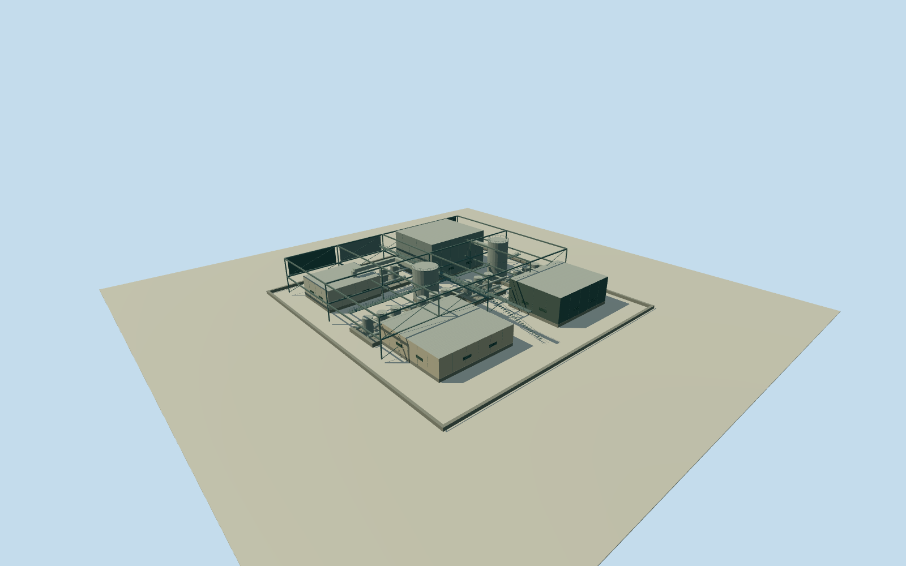

# Olympic Dam west process block

Whole independently placed western process block at Olympic Dam, retaining the complete original four-corner numerical plan. Full open industrial framework and several approximate equipment housings, internal vessels, ducts and maintenance platforms; independent perimeter foundations/pads preserve open ground between equipment. Neighboring separately mapped structures remain separate. Existing published Qualla NASA ISS038-E-29810 original first, followed by the existing NASA ISS038-E-29809 western block detail. Both exact originals and native NASA JSC mission/roll/frame public-domain releases bound. The block shows multiple equipment/roof masses and exposed structure, not one uniform pale warehouse roof. Complete block outline is original numerical geometry; internal layout, heights, sections, materials, equipment census, function, access, exact date continuity and vertical tie are explicit unmeasured estimates. No photographic texture, report graphics or asserted visible flame. Nominal5m horizontal and6m vertical/component uncertainty, not survey or measured bounds. Whole original four-corner133m-scale process block. Perimeter foundation strips, independent equipment pads, complete open steel framework, four roofed equipment housings, two contained vertical vessels, duct routes and maintenance walks. Open ground between equipment remains visible; no uniform roof or site-wide building proxy. Adjacent individually mapped buildings and round vessels remain separate. Parent mine unfinished. All internal equipment layout and component census are original medium-fi estimates guided by broad original photograph arrangement, not a measured process survey. Initial floor0.25m/foundation-1.2m; frame levels8.25m and17.25m; housing tops9.25/19.25/8.25/12.25m; vessel tops15.25/20.25m. Heights and sections unmeasured. Nominal12m height/component and5m horizontal allowances are estimates, not measured error bounds. No named furnace/process identity or operating flame claimed. Pale bright module uses ordinary pale material without emission. Original published Qualla NASA ISS038-E-29810 first and existing published ISS038-E-29809 for the western block. Both native NASA JSC ESRS mission/roll/frame public-domain releases and exact local image bytes bound. No photo texture, copyrighted report figure or other appearance source. Exact2014-to2026 footprint continuity, detailed condition and equipment identity unverified. Own independent512m129x129/16641height source field and raw source tile acquired before initial floor/main sections. Geographic frame, original field, floor and main sections frozen. No masking, flattening, roof/floor fitting or terrain cutout. Coarse grade can disagree with equipment foundations; no surveyed vertical tie. Four complete authoredLODs retain original perimeter controls, all main housings, contained vessels, full framework, ducts and maintenance deck silhouettes. Near levels add frame bracing, rails, stairs, vessel collars and equipment face divisions. Internal yard openings remain open. Historical2014context preview/currentworldeligiblefalse.

Authoring state: **review-in-qa.json**. Current completion evidence is in [qa.json](qa.json) and the [completion ledger](../../../../qualla-structures/batches/qualla-002.PROGRESS.md).

- [Olympic Dam mine](https://qualla.com/olympic-dam-mine/)

Whole independently placed western process block at Olympic Dam, retaining the complete original four-corner numerical plan. Full open industrial framework and several approximate equipment housings, internal vessels, ducts and maintenance platforms; independent perimeter foundations/pads preserve open ground between equipment. Neighboring separately mapped structures remain separate. Existing published Qualla NASA ISS038-E-29810 original first, followed by the existing NASA ISS038-E-29809 western block detail. Both exact originals and native NASA JSC mission/roll/frame public-domain releases bound. The block shows multiple equipment/roof masses and exposed structure, not one uniform pale warehouse roof. Complete block outline is original numerical geometry; internal layout, heights, sections, materials, equipment census, function, access, exact date continuity and vertical tie are explicit unmeasured estimates. No photographic texture, report graphics or asserted visible flame. Nominal5m horizontal and6m vertical/component uncertainty, not survey or measured bounds.

Whole original four-corner133m-scale process block. Perimeter foundation strips, independent equipment pads, complete open steel framework, four roofed equipment housings, two contained vertical vessels, duct routes and maintenance walks. Open ground between equipment remains visible; no uniform roof or site-wide building proxy. Adjacent individually mapped buildings and round vessels remain separate. Parent mine unfinished.

All internal equipment layout and component census are original medium-fi estimates guided by broad original photograph arrangement, not a measured process survey. Initial floor0.25m/foundation-1.2m; frame levels8.25m and17.25m; housing tops9.25/19.25/8.25/12.25m; vessel tops15.25/20.25m. Heights and sections unmeasured. Nominal12m height/component and5m horizontal allowances are estimates, not measured error bounds. No named furnace/process identity or operating flame claimed. Pale bright module uses ordinary pale material without emission.

Original published Qualla NASA ISS038-E-29810 first and existing published ISS038-E-29809 for the western block. Both native NASA JSC ESRS mission/roll/frame public-domain releases and exact local image bytes bound. No photo texture, copyrighted report figure or other appearance source. Exact2014-to2026 footprint continuity, detailed condition and equipment identity unverified.

Own independent512m129x129/16641height source field and raw source tile acquired before initial floor/main sections. Geographic frame, original field, floor and main sections frozen. No masking, flattening, roof/floor fitting or terrain cutout. Coarse grade can disagree with equipment foundations; no surveyed vertical tie.

Four complete authoredLODs retain original perimeter controls, all main housings, contained vessels, full framework, ducts and maintenance deck silhouettes. Near levels add frame bracing, rails, stairs, vessel collars and equipment face divisions. Internal yard openings remain open. Historical2014context preview/currentworldeligiblefalse.

Build: `node content/worldgen/source/places/r4/r49/olympic_dam_west_process_block/models/generate-house.mjs`. Add `--check` to verify exact regeneration. 12246 triangles; 6 materials; no embedded photographs.
