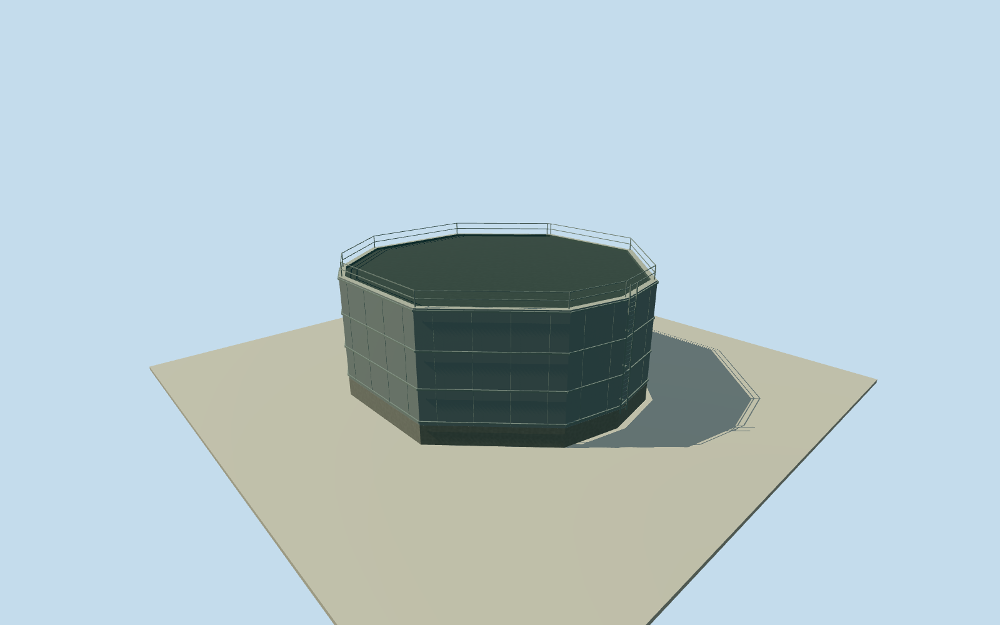

# Olympic Dam western south process vessel

Whole independently placed western round process vessel at Olympic Dam. All eleven original numerical outer controls retained, complete shell/foundation/dark top surface/upper lip and estimated collars, safety rails and access ladder. Other plant bodies and the large adjacent process block remain separate. Original published Qualla NASA ISS038-E-29810 inspected first; another existing Qualla NASA JSC original ISS038-E-29809 shows the three western round bodies and their dark tops more clearly. Both exact original image bytes and native NASA mission/roll/frame public-domain releases bound. Complete round vessel morphology; actual height, top cover versus contents, materials, collars, access details, named process identity, vertical tie and exact2014-to2026 continuity remain unmeasured estimates. No photographic texture or report graphics. Nominal5m horizontal and6m vertical/component uncertainty, not survey or measured bounds. Whole original eleven-control independent round process vessel. Complete original outer shell, foundation, shallow upper lip and opaque dark top appearance surface. Top cover versus contents remains unresolved; no gabled roof, named process function or measured equipment census asserted. Other mine members remain separate; parent unfinished. Explicit initial section estimates chosen after own source field: floor0.25m, foundation bottom-1.2m, shell/lip8.25m, dark top8.05m, safety rail9.30m. Body height8m above floor, not a measured dimension. Nominal6m height/component and5m horizontal allowances are estimates, not measured error bounds. Collar bands, panel joints, safety rail and access ladder/facing are original approximate details. Original published Qualla NASA ISS038-E-29810 first, followed by existing published NASA ISS038-E-29809 for the western round-body group. Both exact original bytes and native NASA JSC ESRS mission/roll/frame public-domain releases bound. No photo texture or report graphics. Numerical outline retrieved2026; exact2014continuity, material finish and process identity unverified. Independent512m129x129/16641height source field/1rawtiles acquired before this initial floor and main section. Frame, field and sections frozen; no masking, flattening, floor fitting or terrain cutout. Exact vertical registration and foundation contact unverified. Four complete authoredLODs retain all eleven original numerical outer controls, full shell/foundation/lip/dark top. District adds collars; street and closeup restore safety rails, access ladder and panel joints. Historical2014context preview/currentworldeligiblefalse.

Authoring state: **review-in-qa.json**. Current completion evidence is in [qa.json](qa.json) and the [completion ledger](../../../../qualla-structures/batches/qualla-002.PROGRESS.md).

- [Olympic Dam mine](https://qualla.com/olympic-dam-mine/)

Whole independently placed western round process vessel at Olympic Dam. All eleven original numerical outer controls retained, complete shell/foundation/dark top surface/upper lip and estimated collars, safety rails and access ladder. Other plant bodies and the large adjacent process block remain separate. Original published Qualla NASA ISS038-E-29810 inspected first; another existing Qualla NASA JSC original ISS038-E-29809 shows the three western round bodies and their dark tops more clearly. Both exact original image bytes and native NASA mission/roll/frame public-domain releases bound. Complete round vessel morphology; actual height, top cover versus contents, materials, collars, access details, named process identity, vertical tie and exact2014-to2026 continuity remain unmeasured estimates. No photographic texture or report graphics. Nominal5m horizontal and6m vertical/component uncertainty, not survey or measured bounds.

Whole original eleven-control independent round process vessel. Complete original outer shell, foundation, shallow upper lip and opaque dark top appearance surface. Top cover versus contents remains unresolved; no gabled roof, named process function or measured equipment census asserted. Other mine members remain separate; parent unfinished.

Explicit initial section estimates chosen after own source field: floor0.25m, foundation bottom-1.2m, shell/lip8.25m, dark top8.05m, safety rail9.30m. Body height8m above floor, not a measured dimension. Nominal6m height/component and5m horizontal allowances are estimates, not measured error bounds. Collar bands, panel joints, safety rail and access ladder/facing are original approximate details.

Original published Qualla NASA ISS038-E-29810 first, followed by existing published NASA ISS038-E-29809 for the western round-body group. Both exact original bytes and native NASA JSC ESRS mission/roll/frame public-domain releases bound. No photo texture or report graphics. Numerical outline retrieved2026; exact2014continuity, material finish and process identity unverified.

Independent512m129x129/16641height source field/1rawtiles acquired before this initial floor and main section. Frame, field and sections frozen; no masking, flattening, floor fitting or terrain cutout. Exact vertical registration and foundation contact unverified.

Four complete authoredLODs retain all eleven original numerical outer controls, full shell/foundation/lip/dark top. District adds collars; street and closeup restore safety rails, access ladder and panel joints. Historical2014context preview/currentworldeligiblefalse.

Build: `node content/worldgen/source/places/r4/r49/olympic_dam_western_south_process_vessel/models/generate-house.mjs`. Add `--check` to verify exact regeneration. 1807 triangles; 3 materials; no embedded photographs.
