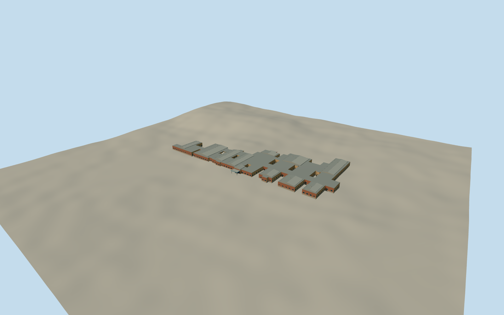

# Broken Hill Hospital

Standing Broken Hill hospital in its full mapped hospital wings and six open courtyards. Low linked masonry and corrugated-metal wings, a raised Thomas Street foyer, and the integrated rear emergency access.

Authoring state: **review-in-qa.json**. Current completion evidence is in [qa.json](qa.json) and the [completion ledger](../../../../qualla-structures/batches/qualla-003.PROGRESS.md).

- [Broken Hill Hospital](https://qualla.com/broken-hill-hospital/)

Ward eaves, roof pitches, levels, courtyard treatment, windows, materials palette and entrance canopies are estimated from the mapped shape and documented materials. The six courtyard rings and the street alignment come from the native map.

Awning locations are inferred within the mapped Thomas Street projection and the rear car-park side. Site structures outside the current main building outline are outside this model’s scope.

The original elevation field remains unchanged. Foundation steps and local thresholds are approximated from the coarse grade at the physical wing and entrance positions.

Build: `node content/worldgen/source/places/r4/r4k/broken_hill_hospital/models/generate-broken-hill-hospital.mjs`. Add `--check` to verify exact regeneration. 5542 triangles; 6 materials; no embedded photographs.
