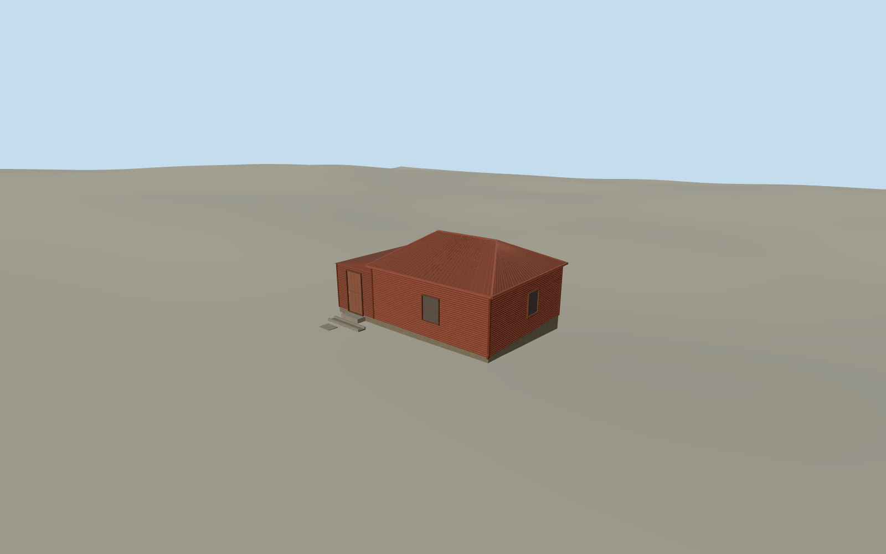

# Broken Hill Mosque

Broken Hill Mosque is a low rust-red corrugated-iron mosque with a hipped prayer-room roof, attached anteroom and simple washing approach.

Authoring state: **review-in-qa.json**. Current completion evidence is in [qa.json](qa.json) and the [completion ledger](../../../../qualla-structures/batches/qualla-003.PROGRESS.md).

- [Broken Hill Mosque](https://qualla.com/broken-hill-mosque/)

The red cladding and main hipped roof follow the exact published photo. The approach channel, anteroom section and windows partly obscured by vegetation are approximate.

The separate relocated West Camel Camp mosque, museum exhibits, landscaping, and vegetation are outside the principal building scope.

Build: `node content/worldgen/source/places/r4/r4k/broken_hill_mosque/models/generate-broken-hill-mosque.mjs`. Add `--check` to verify exact regeneration. 4120 triangles; 6 materials; no embedded photographs.
