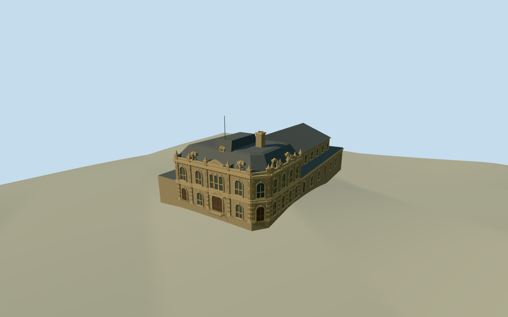

# Broken Hill Trades Hall

The historic Broken Hill union hall with a chamfered corner, arched stone openings, iron mansard, finials and an attached assembly hall.

Authoring state: **review-in-qa.json**. Current completion evidence is in [qa.json](qa.json) and the [completion ledger](../../../../qualla-structures/batches/qualla-004.PROGRESS.md).

- [Broken Hill Trades Hall](https://qualla.com/broken-hill-trades-hall/)

Draft exterior: approximate photographic proportions and simplified ornament. It is not a survey, photogrammetric reconstruction or approved current geographic replacement.

Circa-1910s archived exterior photograph, and the Australian UNESCO nomination’s masonry, iron mansard and hall descriptions fix the upper massing and ornament.

Terrain sampling/contact, geographic alignment and site activation remain pending. Runtime LODs are produced by the registered after-import pipeline and require visual review.

Reference photos remain in the local Qualla corpus; only provenance, paths and hashes are retained here.

Build: `node content/worldgen/source/places/r4/r4k/broken_hill_trades_hall/models/generate-broken-hill-trades-hall.mjs`. Add `--check` to verify exact regeneration. 7929 triangles; 6 materials; no embedded photographs.
