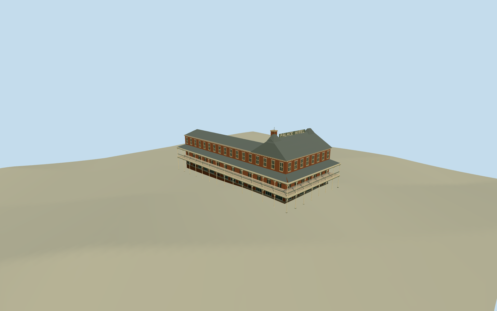

# Palace Hotel, Broken Hill

The Palace Hotel with the three-storey Victorian brick exterior, tall hipped roof and continuous two-level iron verandas on Argent and Sulphide Streets.

Authoring state: **review-in-qa.json**. Current completion evidence is in [qa.json](qa.json) and the [completion ledger](../../../../qualla-structures/batches/qualla-004.PROGRESS.md).

- [Palace Hotel, Broken Hill](https://qualla.com/palace-hotel-broken-hill/)

Draft exterior: approximate photographic proportions and simplified ornament. It is not a survey, photogrammetric reconstruction or approved current geographic replacement.

The hotel’s original 1925 photograph, corroborated by the city masterplan, and the state register’s architectural description identify the three storeys, twin steep hips and two-level cast-iron veranda.

Terrain sampling/contact, geographic alignment and site activation remain pending. Runtime LODs are produced by the registered after-import pipeline and require visual review.

Reference photos remain in the local Qualla corpus; only provenance, paths and hashes are retained here.

Build: `node content/worldgen/source/places/r4/r4k/palace_hotel_broken_hill/models/generate-palace-hotel-broken-hill.mjs`. Add `--check` to verify exact regeneration. 13591 triangles; 6 materials; no embedded photographs.
