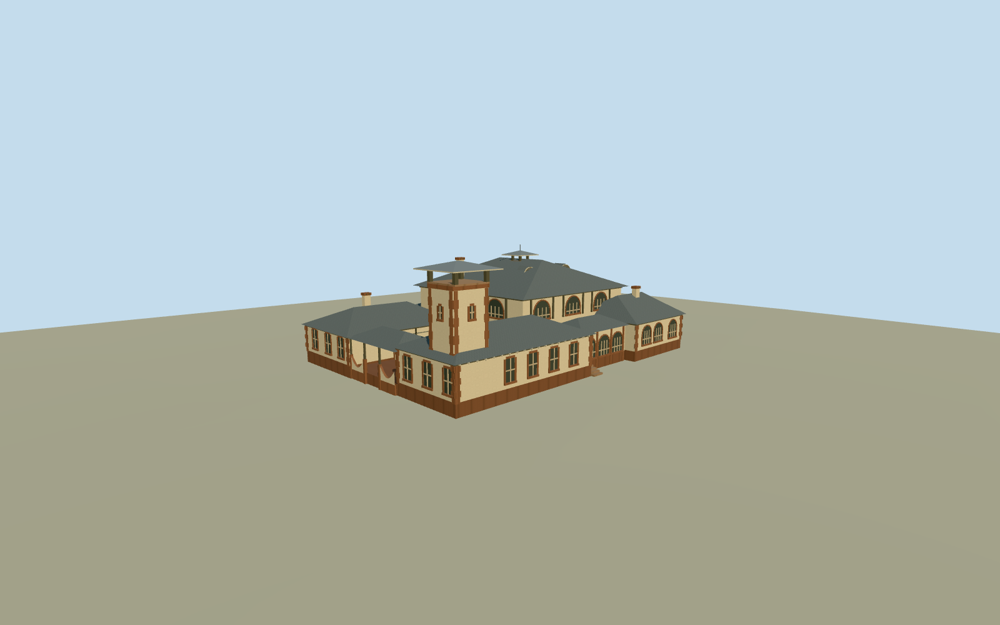

# Bourke Court House

Bourke Court House with the open corner lantern, slate-roofed courtroom, its arched clerestory and open shaded courtyard.

Authoring state: **review-in-qa.json**. Current completion evidence is in [qa.json](qa.json) and the [completion ledger](../../../../qualla-structures/batches/qualla-004.PROGRESS.md).

- [Bourke Court House](https://qualla.com/bourke-court-house/)

The old photographs record the architectural form and the heritage register records later restoration. Roof pitches, small rear volumes and brick and render colors are estimates.

The national elevation source resolves broad grade. Individual steps and courtyard paving levels are estimated.

Build: `node content/worldgen/source/places/r4/r4x/bourke_court_house/models/generate-bourke-court-house.mjs`. Add `--check` to verify exact regeneration. 8158 triangles; 6 materials; no embedded photographs.
