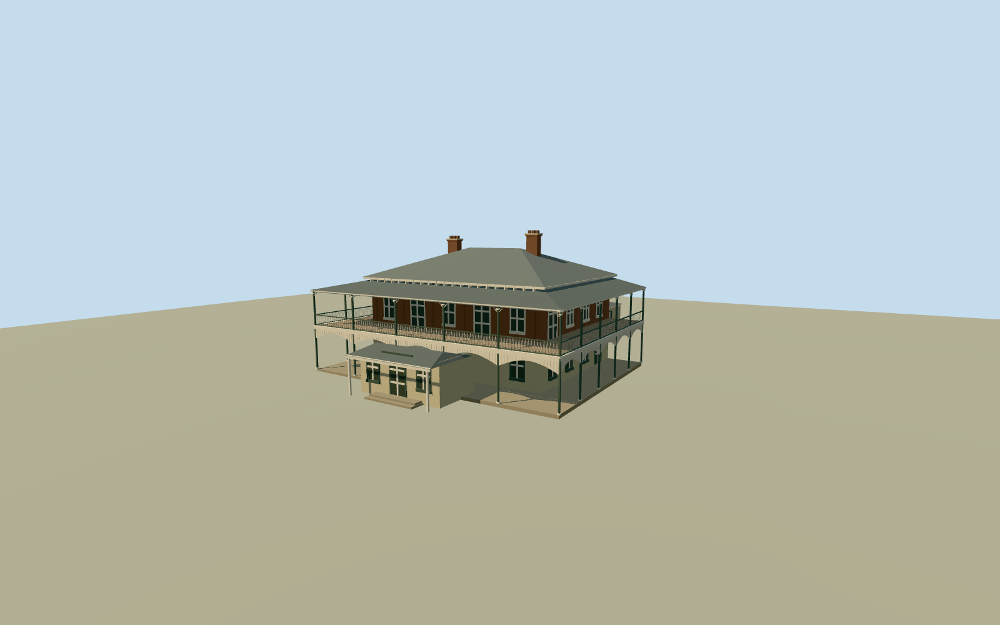

# Bourke Post Office

Bourke Post Office’s corrugated iron hips, corbelled chimneys, decorated verandah and Oxley Street entrance lobby.

Authoring state: **review-in-qa.json**. Current completion evidence is in [qa.json](qa.json) and the [completion ledger](../../../../qualla-structures/batches/qualla-004.PROGRESS.md).

- [Bourke Post Office](https://qualla.com/bourke-post-office/)

The state archive image precedes the front lobby. The lobby follows the published state heritage description and its exact offsets are estimated.

Plan dimensions, rear service wing details, finish variations and small joinery are estimated.

The national elevation source resolves river plain grade at approximately 31 metres, so it cannot resolve front steps or the paved footpath.

Build: `node content/worldgen/source/places/r4/r4x/bourke_post_office/models/generate-bourke-post-office.mjs`. Add `--check` to verify exact regeneration. 12296 triangles; 6 materials; no embedded photographs.
