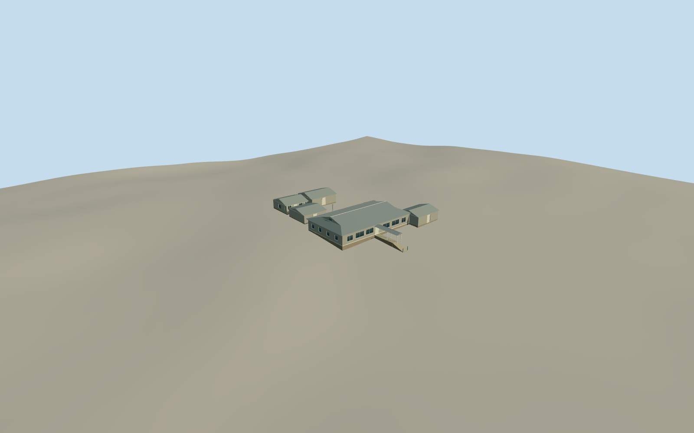

# Australian Inland Mission Hospital, Birdsville

Historic Birdsville hospital with a low galvanized gabled hip, enclosed verandahs, a covered entrance and the distinct former Aboriginal ward.

Authoring state: **review-in-qa.json**. Current completion evidence is in [qa.json](qa.json) and the [completion ledger](../../../../qualla-structures/batches/qualla-003.PROGRESS.md).

- [Australian Inland Mission Hospital, Birdsville](https://qualla.com/australian-inland-mission-hospital-birdsville/)

The native outlines and Queensland’s protected parcel fix the plan. Roof pitch, porch and opening heights, window divisions, and some outbuilding roles are approximations from the register’s written description.

The former ward is the southeastern mapped outbuilding. The register distinguishes its open front verandah and enclosed rear, and records hinged corrugated shutters. The two lesser yard structures are mapped and use simple forms.

The unchanged Terrarium field preserves the terrain context. Absolute heights and contact registration are approximate. No imagery was used for the reconstruction.

Build: `node content/worldgen/source/places/r5/r57/australian_inland_mission_hospital_birdsville/models/generate-australian-inland-mission-hospital-birdsville.mjs`. Add `--check` to verify exact regeneration. 1370 triangles; 6 materials; no embedded photographs.
