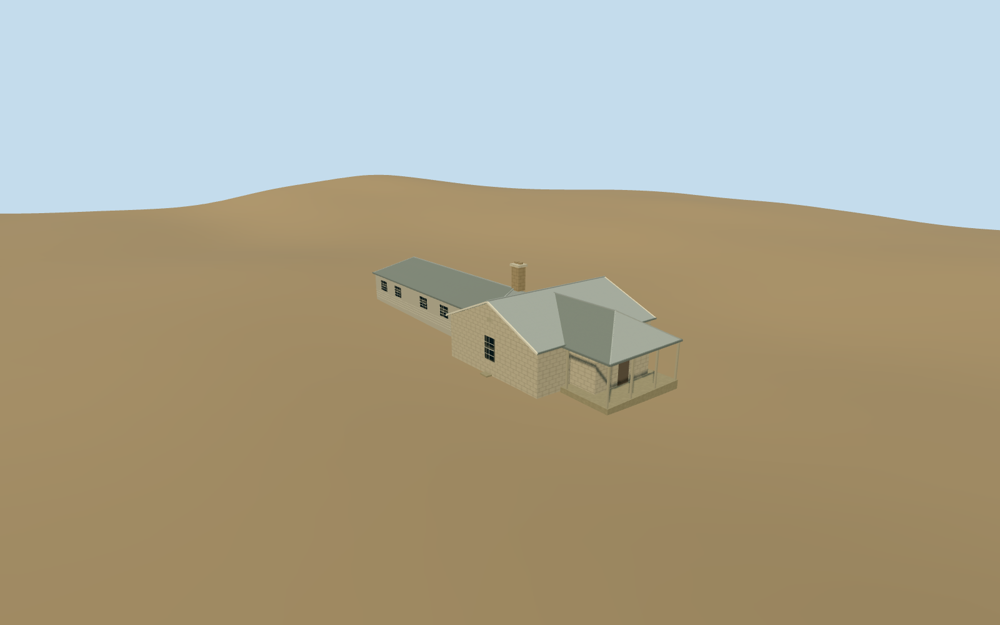

# Birdsville Courthouse

Birdsville’s sandstone courthouse and attached residence, with corrugated roofs, the east hipped courtroom veranda and south gable.

Authoring state: **review-in-qa.json**. Current completion evidence is in [qa.json](qa.json) and the [completion ledger](../../../../qualla-structures/batches/qualla-003.PROGRESS.md).

- [Birdsville Courthouse](https://qualla.com/birdsville-courthouse/)

The circa-1925 photograph establishes persistent roof, post and masonry features. Later enclosures use the written heritage description and the current mapped roof perimeter.

The pale limewash represents the surveyed historical treatment. Present shades, enclosure openings, joinery and exact heights are estimated.

The separate lockup and Aboriginal tracker’s hut are outside the mapped courthouse model. An original open terrain field is sampled without sculpting.

Build: `node content/worldgen/source/places/r5/r57/birdsville_courthouse/models/generate-birdsville-courthouse.mjs`. Add `--check` to verify exact regeneration. 754 triangles; 5 materials; no embedded photographs.
