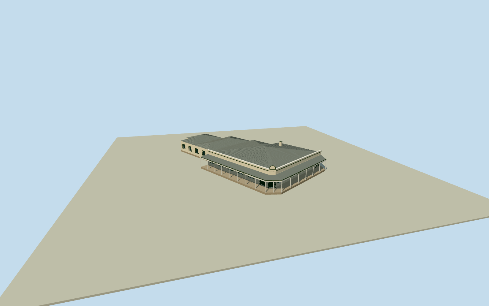

# Birdsville Hotel

Whole surviving BirdsvilleHotel in its actual14-control current mainbuilding envelope: single-storey pale renderedstone, darkgreen steppedquoins/recessed sash/doors, corrugated hippedmainroof and attachedrear roofs, truncated corner entrance/raisedarchedtablet/lowparapet, openwraparound canopy on white timberposts/scallopedvalance and lowconcretepad. Published1927PD original first plus distinct exact2007photographer-ownPD exterior fromlocalcorpus. Hiddenrear roofdivisions/currentfinish/census bounded; separate motel/yard/RoyalHotelruin excluded.

Authoring state: **review-in-qa.json**. Current completion evidence is in [qa.json](qa.json) and the [completion ledger](../../../../qualla-structures/batches/qualla-002.PROGRESS.md).

- [Birdsville Hotel](https://qualla.com/birdsville-hotel/)

Actual named current14-control surviving hotel building envelope; fixednativebboxanchor/heading0 before independentoriginalfield/floor/sections/geometry. Canopy inset/wall/roof subdivisions original photo-bounded, not native measured partpolygons.

Actual14-control hotel building envelope physically retained in full low verandah/foundation and continuous roof/eave plan. Street-side body set back2.6m behind intrinsic openverandah on native edges1/2/3; rear body retains actual native outline. Hipped mainroof and attachedrear roof subdivisions/windowcensus/sections are original photographic estimates, not separately surveyed native buildingparts. Adjacent RoyalHotel ruin, motel blocks/sheds/tanks/openyard excluded.

Independent original256m129x12916641samples/four rawTerrariumtiles/nativebboxanchor/heading0 frozen before once-only exterior floor-1.3696m/SW49.3593m providerdatum and all verticalsections. Originalphoto-bounded single-storey wall3.95m/parapet4.65/cornerbadge5.55/mainhipridge5.7/rearhipridge4.65/awning3.03–3.32/whiteposts/scallopedvalance/windows1.0–2.4/door2.68/depth.22. Current hiddenrear roofdivisions/census/finecondition/colors/contact are bounded estimates, not measured survey. No later floor/sections/field fitting/flattening/reframe/reacquire/raising.

Published CliffEveritt1927wholefrontPD original first; distinct StuartEdwards2007ownPD corner/longface original alreadycachedlocally and independentlyboundnative. No imagery pixels embedded, no excluded aerial/QHRCCpicture or source metadata repair.

Rear roof subdivisions/window/door census, current fine repairs/colors, exact parapet/valance profiles and hiddenfaces are bounded original estimates. Plain original lettering omits advertising/artwork. Detached motels/yard/beer garden/tanks/sheds/RoyalHotelruin/street/airport/aircraft/people excluded.

Original independent field/floor/sections fixed before geometry; contact unverified, preview only/replacementfalse. Flatground/synthetic neighborhouses are review fixtures.

Build: `node content/worldgen/source/places/r5/r57/birdsville_hotel/models/generate-birdsville-hotel.mjs`. Add `--check` to verify exact regeneration. 20481 triangles; 5 materials; no embedded photographs.
