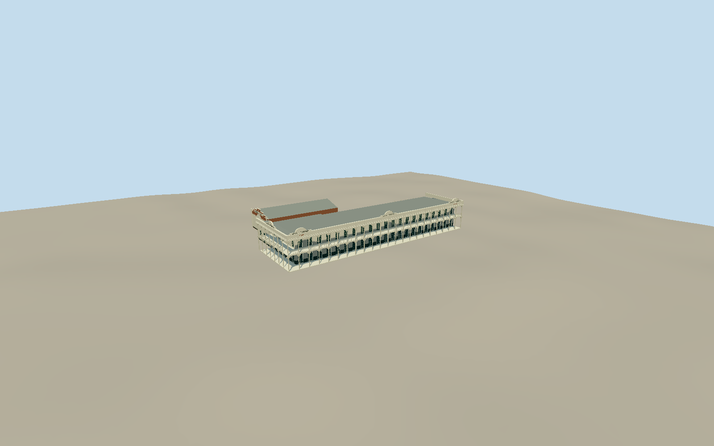

# Hotel Corones

WholeheritageHotelCorones complex: actual64.57mWillsStreetmainhotel/roof-and-return outline, two-storeyopenverandahs/timberposts/brackets/battenrails, highshapedparapets/namepanels/dentilcornice/skillionroof/Frenchdoors/deepgroundwindows/tileddado, rearveranda/mappedkitchenprojection/twinchimneys; intrinsicnorth-easternone-storeyballroom/archedwindows andset-backsteppedbrickCoronesHall/semicircularentrypediment. Ballroom/HallroofpartsareexplicitboundedestimatesinsideQHRlot,notindividualnativefootprints. Separatecontemporarymotel/OldFireStation/modernstaffgarage/streets/floodwater/trees/peopleexcluded.

Authoring state: **review-in-qa.json**. Current completion evidence is in [qa.json](qa.json) and the [completion ledger](../../../../qualla-structures/batches/qualla-002.PROGRESS.md).

- [Hotel Corones](https://qualla.com/hotel-corones/)

Actualnativeway546158499/Q28184281 fixesmain64.5725mstreetroofedge/bearing andirregularrearkitchenoutline. Mainfrontmidpoint[146.24083044999998,-26.40250535],heading-0.9669963003153994,+Xsouth-eastalongWills/+Zsouth-weststreetfront. Nativepolygonincludeswideverandaroof, sohotelwallsetback3.2m/return3.5m withinoutline. QHR601282primaryboundaryanddescription expressly includeadjoiningballroom/Hall; theirunmappedroofsections are boundedestimationsinGalatealot:ballroomz-19.7to-29.2,x-28.5to-6 andHallz-29.2to-43.2,x-25.3to1. NeitherOldFireStationz~-51to-66norCoronesMotelx~22to53 included. PrimarySLQcaption210ftfrontage64.008m corroboratesnative64.57mrooffrontage; noarbitraryreplacementbox. Exactheight/roofdivisions/roomcensus/wingroofplanandsectionsaremedium-fi estimates, notsurvey.

Independent256m129square2m grid/16641originalheights/twooriginalTerrariumtiles frozenbeforegeometry, fixedexternalWillsfootpath[0,6] providerdatum301.1068m. Intrinsicfloor0.4mabovefixedreference fromarchitecturalestimate, notsurveyslab/floodgrade. Footing/skirtoesmayconsume originalfield, nofieldflattening/fitting/reacquisition. Native~4.28moutputpixels mayoversample coarserDEM andnotresolve verandasteps/roomfloors/floodlevels/urbanreturns; exactwall/roof/wingcontactsunsurveyed. Geographicpreviewapproximate/replacementdisabled;1934floodwaternotauthored.

Wholeheritagehotel exterior includeslongmainblock/verandas/parapets/roof/doors/deepwindows/tileddado/rearkitchen/twofireplaces andintrinsicone-storeyballroom/steppedbrickHall. Actualmainroofpolygon andactualQHRlot controlwholemetricextent; ballroom/Hallroofparts areexplicitinferredsectionsinsideQHRboundary basedprimarydescription, notindividuallymappedfootprints or photogrammetry. Hiddenrear/floor/roofdivisions/openingcensus/name/datelettering andsectiondetails medium-fiestimates.

One exactpublished1000x5521934CharlevilleTimes/SLQNeg82855PD-Australiaphotograph controls longfacade/openverandas/posts/brackets/battens/parapet/dentils. No claimofindependentallsidephotographiccoverage orcurrent2026finishes. Neutralivory/graygreen/darktile paletteinferred fromgrayscale/type; no modernCC/galleryphotos or1990PDM-ownerarchiveimage used. Oppositestreetview,1930interiors,1919differentHotelCharleville andQuilpiehotel notadopted. No floodwater/trees/poles/people/logos/unrelatedbuildings/borrowedmeshes/photographictextures/generatedbitmaps.

Main64.57mnativestreetroofedge corroboratesprimarySLQ210ftfrontage. SeparatecontemporaryCoronesMotel546158498,OldFireStation546158497,modernstaffquarters/garages andstreetcontext excluded. Surviving1924-29heritageform, exactcurrentalterations/repairdetailsunsurveyed. Independentground/rawtiles neverflattened/fitted/reacquired; actualfooting/step/floodlevelcontactunverified andgeographicreplacementdisabled.

FourLODs preservewholemainhotel/realopenverandas/twolevels/return/shapedparapets/attachedballroomandsteppedHall/twinchimneys. Nearwindowreveals/Frenchdoormullions/closelyspacedtimberbattens/chamferedpostbrackets/dentils/relieflettering/Halldiamonds returnprogressively. Sixactualsurface slots withfivecanonicalsharedgraphs/localglazing.

Build: `node packages/worldgen/scripts/generate-authored-places.mjs --ids=hotel_corones`. Add `--check` to verify exact regeneration. 16026 triangles; 6 materials; no embedded photographs.
