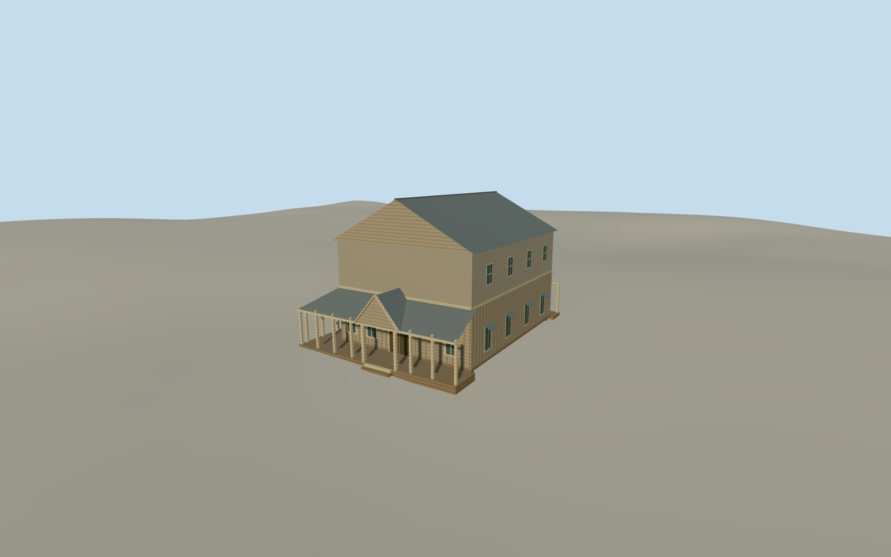

# Blackall Masonic Temple

The standing Blackall Masonic Temple with raised timber walls, a two-storey corrugated gable, and a veranda with a steep Hawthorn Street entrance.

Authoring state: **review-in-qa.json**. Current completion evidence is in [qa.json](qa.json) and the [completion ledger](../../../../qualla-structures/batches/qualla-003.PROGRESS.md).

- [Blackall Masonic Temple](https://qualla.com/blackall-masonic-temple/)

Paint colors are estimates from the documented timber and galvanized iron materials. The archival photo is monochrome.

Veranda subdivisions, eastern stair, rear openings and foundation levels are approximate. The current cafe interior and fittings are outside the exterior scope.

Build: `node content/worldgen/source/places/r5/r5x/blackall_masonic_temple/models/generate-blackall-masonic-temple.mjs`. Add `--check` to verify exact regeneration. 1610 triangles; 5 materials; no embedded photographs.
