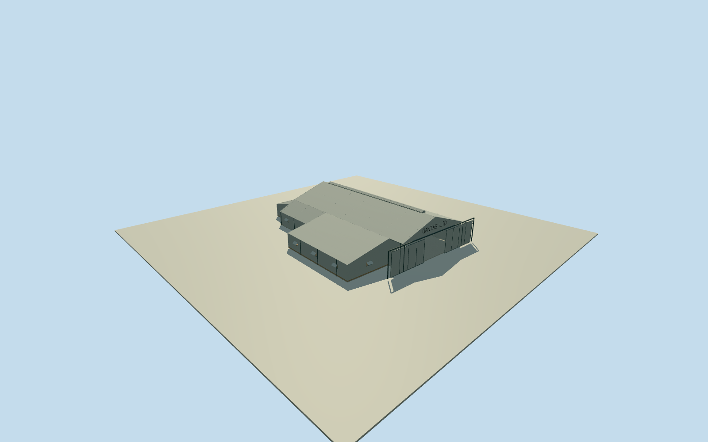

# Qantas Hangar, Longreach (2008)

Whole surviving1922QANTAShangar as museum-era2008 architecturaldescription: complete13vertexnativeoldhangar998728731, large uninterrupted aircraftbay/tubularsteeltrusses/gabledroof/ventilatedridge/corrugatedgalvanisedwallsandroof, intrinsicwest/east/rearannexes, northfrontslidingdoorsandsteeloutriggerframes/tophingedflapwindows/westoffices. Mainconcretefloor/raisedwoodannexfloors, northQANTASLTD andsouthQANTASLTDAIRSERVICES factualsigns fromheritagetext. Exactheights/sections/census/finish/registration/grade are boundedestimates; photographisclearconstructioncontext ratherthan wholeexterior reference. Exclude modernmuseum172840395/airpark/terminal/otherhangars/aircraft/exhibits/people/landscape/interiorfurnishings.

Authoring state: **review-in-qa.json**. Current completion evidence is in [qa.json](qa.json) and the [completion ledger](../../../../qualla-structures/batches/qualla-002.PROGRESS.md).

- [Qantas Hangar, Longreach](https://qualla.com/qantas-hangar-longreach/)

ExactnamedOriginalQ.A.N.T.A.S.FoundersWorkshopway998728731/13uniqueoutercontrols; federalAHCPlace106064/QHR600664scopewholeoldhangar, distinctmodernmuseum/airpark/terminal. Nativeheadingandfootprintfixsite, mainsections/side-rearannexregistration andmuseum-era2008approximate. No airportQID borrowed orunknownQID invented. Allcurrentreservedcandidates/collectionmember IDs/aliases clear.

Whole surviving1922QANTAShangar as museum-era2008 architecturaldescription: complete13vertexnativeoldhangar998728731, large uninterrupted aircraftbay/tubularsteeltrusses/gabledroof/ventilatedridge/corrugatedgalvanisedwallsandroof, intrinsicwest/east/rearannexes, northfrontslidingdoorsandsteeloutriggerframes/tophingedflapwindows/westoffices. Mainconcretefloor/raisedwoodannexfloors, northQANTASLTD andsouthQANTASLTDAIRSERVICES factualsigns fromheritagetext. Exactheights/sections/census/finish/registration/grade are boundedestimates; photographisclearconstructioncontext ratherthan wholeexterior reference. Exclude modernmuseum172840395/airpark/terminal/otherhangars/aircraft/exhibits/people/landscape/interiorfurnishings.

Originalindependent256mfield/frame BEFORE allfloors/mainsections/geometry, thenpreserve. No flattening/reacquisition/reframing/fitting afterrenders.

Onlyprimarydescriptivegeometry establishesgable/ventridge/steeltrusses/corrugatedcladding/sideandrearannexes/northslidingdoorsandoutriggers/flapwindows/westoffices; heights/census/sections/finish/grade estimated. No fakewholeexteriorphotogrammetryclaim.

Onlyalreadycleared1928constructionphoto isimagery; no aircraft/people/props/interiorfurnishing/streetlandscape/phototextures/protectedarchiveimagery. Factualgablelettering may be authoredasoriginalgeometricstrokes from heritageTEXT.

Whole13vertexnativebuilding retainsmainhangar/westofficeworkshop/eastwidethennarrowannex/rearrooms, not wholemodernmuseum orairpark. Primarydescriptionestablishesgableventedroof/tubularsteel/sideandrearannexes/corrugatedcladding/slidingdoorframes/flapwindows/north-southfactuallettering.

Exact18.344mwidth/36.837m mainbay andannexsplit deriveapproximately fromnativeoutline; allheights/roofpitch/sections/7trusscensus/doorleafpositions/windowcensus/finishingcolour/historicgrade are estimates. Galvanisedneutralcolour is uncalibrated, not inferredfromblownout1928background.

Photois1928constructioncontextonly; represented2008museum-eraexterior comesfromprimarygovernmentdescriptivetext andnativefootprint. No claimofwholeexteriorphotographiccomparison orsurvey. No wrongArcherfieldfleet/NLAunboundphoto/protectedwebsitepixels adopted.

Originalfield194.0423mdatum/range189.6482..196.227m mayincludeairport/compositeartifacts andbury lowerparts. Independentfield/frame/allmainparameters preserved afterrenders; no mask/cutout/flattening/reacquisition/refitting.

Mainnorthdoorspartlyopen toempty aircraftbay, withactualsteeltrusses/concretefloor/roofundersides; intrinsicannexwoodfloors modeled, no exhibitaircraft/people/interiorfurnishings. Geometricgabletextstatesfactualheritagewords, no bitmaptrademarkart.

Build: `node content/worldgen/source/places/r5/r5y/qantas_hangar_longreach/models/generate-house.mjs`. Add `--check` to verify exact regeneration. 3047 triangles; 4 materials; no embedded photographs.
