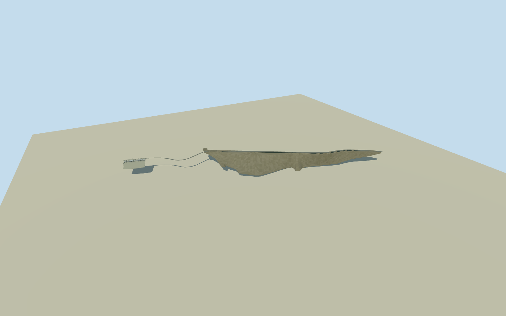

# Copeton Dam, New South Wales (2006)

Complete main1484m embankment and western156m nine-gate spillway, represented in2006 before the separate2013auxiliary spillway. Original54-control main-dam perimeter,11-control spillway perimeter,3-control crossing,17-control crest and16-control connecting road preserved. Native crest1483.76m agrees with operator1484m without scaling. Historical horizontal continuity is approximate; this is not a surveyed2006ground/section reconstruction.

Authoring state: **review-in-qa.json**. Current completion evidence is in [qa.json](qa.json) and the [completion ledger](../../../../qualla-structures/batches/qualla-002.PROGRESS.md).

- [Copeton Dam](https://qualla.com/copeton-dam/)

Complete main1484m embankment and western156m nine-gate spillway, represented in2006 before the separate2013auxiliary spillway. Original54-control main-dam perimeter,11-control spillway perimeter,3-control crossing,17-control crest and16-control connecting road preserved. Native crest1483.76m agrees with operator1484m without scaling. Historical horizontal continuity is approximate; this is not a surveyed2006ground/section reconstruction.

Independent2048m129x129 original field/16641heights/nine raw Terrarium tiles frozen before these floors and main sections. Main central crest-road control and separate bridge east endpoint supply independent original-field levels.113m maximum wall and427m base nominal primary dimensions; valley taper, submerged upstream section, exposed profiles, bridge clearance and gate mechanics are bounded estimates. Original water/void/canopy artifacts retained; source range includes implausible-8685.84m inland pits and is not bathymetry. Never reframe, flatten, reacquire, move floors or reshape main sections to make render contact pass.

2006 dated historical representation; later2013DiamondBay auxiliary spillway absent by date. No current-world activation claim.

One clear creator-PD photo directly establishes spillway appearance. Entire main embankment uses operator dimensions and exact native geometry; no whole-dam photogrammetry claim.

Main mapped perimeter describes exposed body. Submerged upstream slope/foundation, valley taper, material distribution, deck/piers/hoist sizes and rear mechanisms are original engineering estimates.

Mapzen original field has inland no-data/water artifacts and source spacing4.14m is output spacing, not native accuracy.16m review samples are not a survey. No exact2006terrain or host contact certification.

Separate1996hydroelectric power station is an independently named plant, outside this dam asset. No natural hill, reservoir, water sheet, people or adjacent facilities baked into structure.

Build: `node content/worldgen/source/places/r6/r6e/copeton_dam/models/generate-copeton-dam.mjs`. Add `--check` to verify exact regeneration. 8632 triangles; 5 materials; no embedded photographs.
