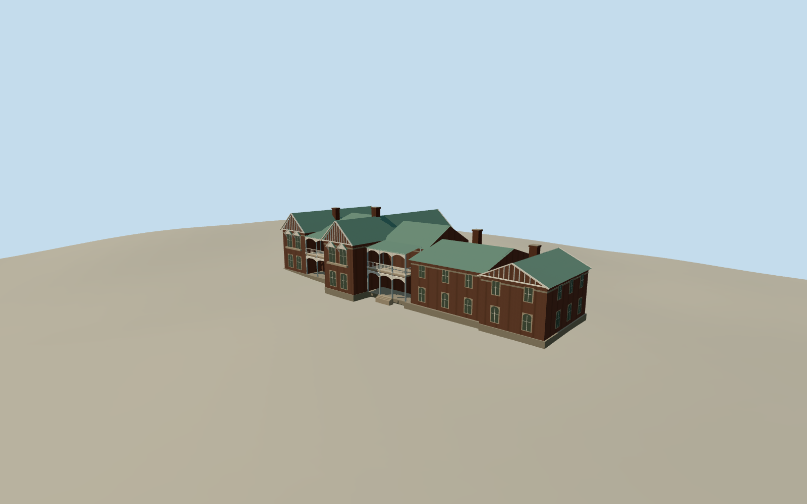

# Saumarez Homestead

The Saumarez brick homestead with green corrugated gables, paired bracketed windows, tall chimneys and two tiers of light verandas.

Authoring state: **review-in-qa.json**. Current completion evidence is in [qa.json](qa.json) and the [completion ledger](../../../../qualla-structures/batches/qualla-003.PROGRESS.md).

- [Saumarez Homestead](https://qualla.com/saumarez-homestead/)

October 2014 exterior of the principal house and its attached ranges. Detached farm buildings and interiors are outside scope.

The northwest elevation is based on the cleared photograph. Rear and side elevations, roof joins, absolute heights and fine decorative joinery are estimates.

Original terrain samples are preserved. Foundation and entrance step heights use the original grade near the photographed northwest elevation.

Build: `node content/worldgen/source/places/r6/r6e/saumarez_homestead/models/generate-saumarez.mjs`. Add `--check` to verify exact regeneration. 3146 triangles; 5 materials; no embedded photographs.
